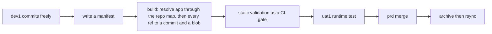

<!-- TermiteTowers Continuous Code Management Header TEMPLATE --- %ccm_git_header_start:  % -->
<!-- %ccm_git_repo: TermiteTowers % -->
<!-- %ccm_git_branch: dev1 % -->
<!-- %ccm_git_path: docs/design/promotion-model.md % -->
<!-- %ccm_git_object_id: docs/design/promotion-model.md@218 % -->
<!-- %ccm_git_commit_date: 2026-11-13 14:50:44 -0500 % -->
<!-- %ccm_git_commit_author: mpegg % -->
<!-- %ccm_git_commit_message: changes 261113 % -->
<!-- TermiteTowers Continuous Code Management Header TEMPLATE --- %ccm_git_header_end:  % -->
<!-- %git_commit_history: 2026-11-09 mpegg promote: two artifacts only — manifest and record; inventory removed (D20) -->
<!-- %git_commit_history: 2026-11-09 mpegg docs: package spec — curated selection between inventory and record -->
<!-- %git_commit_history: 2026-11-09 mpegg docs: remove the last dit references from the flow and audit sections -->
<!-- %git_commit_history: 2026-11-09 mpegg docs: drop the dit tier; static validation becomes a CI gate on the promote branch -->
<!-- %git_commit_history: 2026-11-09 mpegg nginx: retire tag-viewer symlinks into AnalAcres; document the publish gap -->
<!-- %git_commit_history: 2026-11-09 mpegg promotion: manifest inventory, record generator, deploy archive/restore -->
# Promotion model — manifest-based promotion

**Status:** design agreed, nothing implemented. This document is the reference the
implementation is measured against, and the place where accepted debts are recorded
so they stop being rediscovered.

**Nothing in this document may be inferred from the code.** The shipped engine takes one
`--repo-root` and therefore promotes within a single repository; that is an implementation
shortcut, not the design. Cross-repo promotion is the design — §4.5, §4.6, D10, D21 — and a
reading of `scripts/promote/tt-promote.py` that concludes otherwise is reading the wrong
artifact. This paragraph exists because that inference was drawn once (P19).

**Scope:** how a change reaches `prd` in this repository. Not how services are
installed, not how secrets are managed, not how a runner is registered — those
have their own documents.

`docs/` is outside `docs_dir: wiki`, so this page is tracked and CCM-managed but
never published.

---

## 1. Why not branches

Feature branches were considered and rejected. The reasons are specific, not
philosophical:

- **Commits on `dev1` are not atomic.** They are named `zoo.261109`. `git
  cherry-pick` promotes whole commits, so it can only work if every commit is a
  coherent, reviewable unit.
- **`git merge dev1` promotes everything since the merge base**, which on a
  working branch is unusable.
- The unit of promotion here is **a chosen set of paths at chosen versions**, and
  the artifact that expresses it is a manifest.

The capability this buys that branch-merge promotion cannot: **the promotion is
replayable**. Rollback is "apply record N-1", not "reconstruct what prod looked
like last Tuesday".

The door is one-way. Once `prd` never merges from `dev1`, a later merge is
unresolvable. Merges, rebases and `git checkout dev1 -- <path>` are therefore
**blocked on `prd`**, not merely discouraged: the promote record is the only
evidence that content on `prd` was deliberate.

---

## 2. The model

- A **manifest** is the curated selection for one promotion, authored by hand. It
  names the exact files to promote, and may remap or pin any of them. It is the only
  artifact that expresses intent, and the only one allowed to contain a symbolic ref.
  It has no required size: five lines, or two hundred when a packaging step wants the
  whole list.
- A **record** is generated from a manifest. It pins every operation to a concrete
  commit and blob, and contains no refs at all. It is reviewed every time.
- **Only real changes land.** A two-hundred-entry manifest that changes one file
  produces a one-file commit on the target, because the apply writes each blob and an
  identical blob produces no diff. Manifest size is a style choice, not a risk.
- The record is the **audit artifact**. Not the git history of `prd`, not the
  `uat1` tree's history, not the CCM history trail.

---

## 3. Tiers and reset policy

Rungs differ by **reset policy**, not by seniority:

| Tier | Reset policy | Purpose | History is |
|---|---|---|---|
| `dev1` | never reset, deliberately messy | the work | the work |
| `uat1` | accumulated, promoted into; may accept fixes | the runtime tier: services actually start | the smoke surface |
| `prd` | accumulated | production | the promote records |

`sit` and `uat` are **test phases**, not environments. Do not add an environment
for them.

### Why there is no `dit`

A `dit` rung was considered and **dropped on 2026-11-09**. It existed for two
reasons, and both have since gone:

1. **Separating the operator's smoke test from QA's acceptance test.** There is no
   QA here — the same person does both — so a separate clean room separates a person
   from themselves. That is a burden, not a gate.
2. **Acting as the completeness catch-net**, because in a transfer-spec manifest
   forgetting is silent by default. That is answered by a diff instead: `git diff
   origin/prd...dev1` lists every add, modify and delete between the tiers, so "what
   did I miss" is a query over the two trees, not a third file that can itself be
   stale.

**The static validation the rung would have performed is retained as a CI job on the
promote branch, not as a tier.** The checks are unchanged — the record applies
cleanly, every blob verifies, every destination appears once, dependent files exist,
config files parse, and no deletion is unaccounted for — but they run as a gate over a
branch, with no destination directory and no environment to keep alive.

An integration rung aggregating several dev branches remains possible later, and the
record format already supports it: every entry carries its own source ref and commit.
Reintroduce a tier then, not now. This section exists so the question is not
re-litigated from scratch.

Because `uat1` accumulates, a promote may pin `uat1` rather than `dev1` for a fixed
path. That divergence is legitimate and the drift report is what reminds you to
back-port it.

---

## 4. Artifacts

There are two: a **manifest** you author, and a **record** it resolves to. That is the
whole model.

An **inventory** — a committed list of every path an app owns — is deliberately *not*
an artifact here. It was removed on 2026-11-09 (D20). If a build or packaging step
needs a file list, that list is an input to *that* process and can be expressed as a
manifest. Until such a step exists there is nothing for an inventory to do, and a
stored file would only cache something git already answers:

```bash
git diff --diff-filter=D origin/prd...dev1    # what should be deleted
git diff --name-status origin/prd...dev1      # what changed at all
```

### 4.1 The manifest — curated selection

The package is the only artifact a human authors per promotion. It says *what you
chose*, which the inventory cannot say and the record must not invent. It is also the
**only** place a symbolic ref is permitted, because resolution happens exactly once,
between package and record.

A package is never generated. Generating it would put the machine back in the position
of deciding what to promote, which is the thing this model exists to prevent.

#### Line grammar

```
<op> <src>[@<ref>] [-> <dst>]
```

| op | meaning |
|---|---|
| `+` | copy or update: take `src` at `ref` (default: the package's `from:`) and write it to `dst` (default: the same path) |
| `-` | delete the target path. File only — a directory delete is an unbounded destructive set dressed as one line |

Deliberately absent: globs, directory entries, and exclude patterns. Any of the three
makes the promoted set unbounded, which destroys both reproducibility and review.

`@<ref>` on a single line lets one path be pinned to a different commit than the
package default. That is the hook fan-in from multiple dev branches would use later,
and it costs nothing to have now.

#### Header

Key-value lines before the first entry:

| key | required | meaning |
|---|---|---|
| `package:` | yes | identifier, matching the filename stem |
| `app:` | yes | the **target** app — the repository that receives the record — resolved through the repo map in §4.5. A name that resolves to no repository is not an answer |
| `from:` | yes | source ref: a branch, a tag, a SHA, or `latest` |
| `to:` | yes | destination tier; must match a real branch |
| `reason:` | yes | one line, for the human reading the record six months later |

#### Example

```
# promote/packages/2026-11-09-docs.pkg

package:  2026-11-09-docs
app:      termitetowers-docs
from:     latest
to:       uat1
reason:   prove the promote mechanism end to end with inert paths only

# identity mapping
+ docs/design/promotion-model.md
+ docs/runbooks/host-deploy-runbook.md

# remapped destination
+ wiki/ports.md -> docs/ports.md

# pinned to a specific commit, not the package default
+ infra/docker/nextcloud-dev1.yml@7c77ce9

# tombstone
- memory-bank/host-deploy-runbook.md
```

#### Resolution

`build` is the only command that interprets `from:`. It performs, in order:

1. Resolve `from:` to a concrete commit.
2. For each `+`: confirm the path exists at that commit, is a blob, and is not mode
   `120000`. Compute its blob sha.
3. Skip an entry whose destination already holds that exact blob — a no-op entry is
   reported, not written.
4. For each `-`: confirm the destination exists on the target, else treat it as
   already absent (idempotent).
5. Emit the record, recording `package_sha` = a hash of the package text, so any record
   traces back to the exact selection that produced it.

#### What build refuses

- a glob, a directory, an absolute path, or `..` in a path
- `src` absent at the pinned commit
- two entries with the same destination — in this package, or in another package aimed
  at the same tier in the same run
- a symlink source
- a path listed in `policy/deny.txt`
- a privileged path **without** an explicit `!`: `+ ! .github/workflows/deploy-uat1.yml`

The `!` check is **bidirectional**. The tool knows which prefixes are privileged and the
human must type `!`; a missing `!` fails the build, and a `!` on an ordinary path also
fails. Approval becomes a deliberate keystroke that cannot drift out of sync with the
classification in either direction — which a tool-computed flag cannot guarantee.

#### Layout

```
promote/
  README.md                    how to author a package, and what build refuses
  apps.txt                     repo map: app -> clone root, remote, default branch (§4.5)
  packages/
    2026-11-09-docs.pkg        hand-authored, one per promotion
  policy/
    deny.txt                   never promotable: env files, secrets, credentials
    privileged.txt             presence-is-behaviour prefixes
  records/
    2026-11-09T1920Z-docs-to-uat1.yaml
```

`policy/` exists so that what is forbidden and what needs approval are diffs in review
rather than constants buried in the tool.

### 4.2 Promote record

```yaml
record_version: 1
id: 2026-11-09T21-40-analacres-prd
package: 2026-11-10-analacres-hooks
package_sha: 3f9c0b1e...                 # hash of the package text
app: analacres                           # the TARGET app: its repo receives this record
applies_to: prd
generated_by: engine@<sha>
entries:
  - op: copy
    source_repo: termitetowers           # a different repository, same record
    src: git-automation/v2/pre-commit.sh
    dst: git-automation/v2/pre-commit.sh
    source_commit: 07c638fcfb4804b40c226db94358725a8b6ef636
    blob: 1fc9b67eb0727868e13ad478eb85fc51b30de794
  - op: copy
    source_repo: analacres               # the target's own repo
    src: scripts/water_meter/common.py
    dst: scripts/water_meter/common.py
    source_commit: 4c1de0f0e0b0d6b1d1f0d0b0e0c0a0b0c0d0e0f0
    blob: 9a1c7e6d5b4f3a2c1d0e9f8a7b6c5d4e3f2a1b0c
  - op: delete
    dst: scripts/retired-thing.sh         # deletes are always the target's
```

**There is no record-level `source_ref` or `source_commit`.** Once two entries can come
from two repositories, a single global pin cannot describe the record, so the per-entry
pin (§4.3) becomes mandatory rather than an override. A record may keep a `source_ref` as a
readability aid when every entry shares one source, and §4.3 already forbids it from
resolving at apply time.

### 4.3 Pinning rules

- **`latest` is an authoring-time alias and is resolved to a concrete SHA at
  generate time.** A committed record never contains `latest`. A record that
  resolves at apply time invalidates the dry run, breaks replay, and breaks
  rollback.
- Every `copy` entry pins the source commit **and** the source blob. Per-entry
  pins, not one global pin — this is what makes multi-source fan-in expressible
  later.
- Cascading overrides must record their **resolved effective entry**, not the
  pattern that produced it. Otherwise the artifact no longer states what lands.

### 4.4 Validation rules

- Leaf paths only; no directories, no globs.
- **At most one entry per destination path within a record**, so a
  replace-with-delete cannot be interpreted two ways by resolution order.
- **Case-collision check** for case-insensitive destinations: a delete naming
  `Foo.yml` must not be able to remove `foo.yml`.
- A path whose git mode is `120000` (symlink) is **not promotable** unless
  explicitly allowlisted, and absolute-path link targets are rejected.

### 4.5 Cross-repo promotion

Nothing in the model requires a record's source and its destination to be the same
repository. That is what the per-entry pin (D5) is for: an entry names a source repo, a
source commit and a blob, and the record applies to one target app. The shipped engine
takes a single `--repo-root`, so it can only express the case where both are that repo —
**an implementation limit, not the design**, recorded here so the next reading of the code
cannot silently redefine the model.

#### Why the engine must hold both repositories at once

A blob sha is only meaningful inside the object store that contains the object. So `apply`
reads the bytes out of the **source** clone and writes them into the **target** workarea:

```
git -C <source clone> cat-file blob <pinned sha>   ->   write   ->   commit in <target clone>
```

That one fact dictates §4.6, and it is exactly what a one-repo argument cannot express: the
two clones have to be reachable by the same process at the same time.

#### Which artifact lives in which repository

> **Superseded in part, 2026-11-09.** The table below puts policy, packages and records in
> the target app repo. That was overruled the same day: policy and manifests move to the
> promote repo, because a contributor must not be able to relax the rule that governs their
> own promotion. See decision S3 in
> [`docs/status/promotion-manifest-handoff.md`](../status/promotion-manifest-handoff.md).
> Everything else in this section stands.

| artifact | lives in | why |
|---|---|---|
| repo map — `apps.txt` | the **promote** repo | it is how the engine finds a clone; it describes no single app |
| package — `*.pkg` | the **target** app repo | it is that app's selection, reviewed with that app |
| record — `*.yaml` | the **target** app repo | the audit artifact belongs with the bytes it describes |
| policy — `deny.txt`, `privileged.txt` | the **target** app repo | it states what *that* repo may not do; a source repo's policy does not travel with its bytes |

A cross-repo build therefore reads three things: the target's policy, the target's package,
and the engine's repo map.

#### The repo map

`app:` stops being a label and becomes a lookup. `apps.txt` maps an app key to the clone the
engine resolves against, its remote, and its default branch:

```
# app          clone root                          remote
termite        /srv/engine/workareas/termite        <remote url>
analacres      /srv/engine/workareas/analacres      <remote url>
```

`app:` names the **target** app, so `from:` and `to:` are branches of *that* repository. A
source in another repository is named explicitly on the entry:

```
+ termite:git-automation/v2/pre-commit.sh     # source in another repo
+ scripts/water_meter/common.py               # source in the target's own repo
- scripts/retired-thing.sh                    # deletes are always the target's
```

**Proposed, not settled:** the `app:path` prefix. The split is resolved by lookup — a prefix
is cross-repo only when it is a known app key — and `build` must refuse rather than guess
when both readings are possible. That refusal is the only guard against a real path that
happens to begin with an app key, so it is a requirement, not a nicety.

#### Adoption, not a runtime dependency

§14.5 says a repo owns its vhost but not another repo's assets, and the `tag-viewer` case is
why: a symlink or an `rsync` from a foreign tree is a live dependency on a tree this repo
does not control. Cross-repo promotion is the other thing. The destination repo **adopts**
the bytes and owns them from then on; the record names where they came from, and the
frozen-origin header (§7) still carries the origin repo and path. Adoption does not erase
provenance and it does not create a dependency — the source repo could be deleted tomorrow
and the target is unaffected.

#### What `build` refuses, in this shape

- an `app:` that is not in the repo map
- an entry whose app key is not in the repo map
- a source blob absent from the source clone's object store
- a `@ref` that resolves in the wrong repository
- a delete entry naming another app — deletes are target-only
- everything in §4.4, applied per destination

### 4.6 The engine's access model

The engine needs a lot of access. The list is short enough to state plainly, so that it can
be reviewed against a requirement set instead of being judged on impressions.

| requirement | why | what breaks without it |
|---|---|---|
| read on every **source** repo | `cat-file` the pinned blob (§4.5) | cross-repo records cannot be applied at all |
| write on every **target** repo | commit and push the record on the target branch | promotion is impossible |
| one workarea per repo per branch | one checkout cannot hold two tiers at once | concurrent promotes corrupt each other (P15) |
| per-destination fine-grained tokens | a stolen token should reach one repo | one token compromises everything (P14) |
| loud auth failure | never report "nothing to promote" when the truth is "could not look" | an auth outage reads as a clean tree (P16) |
| no hooks in any promote workarea | a hook amends the commit and appends history (§7, D9) | the promoted commit is not the reviewed one |

**What "god-like" does not include.** Each exclusion is what keeps the credential set
survivable:

- **No host access.** The engine commits and pushes; the target repo's own workflow deploys
  (D11). No sudo, no systemd, no deploy secrets, no run-area writes.
- **No force-push, no tier reset.** Tiers accumulate (§3); rollback is a *new* commit
  replaying record N-1, never a rewrite of the branch.
- **No write to a repo it holds no promote intent for.** A token that can write everywhere
  is a token that can promote by accident.
- **One audit log, not one repo's history.** The record id is echoed into the target commit
  message (P17), so the target is self-describing and the engine is not needed to read it.

The accepted debt is unchanged and restated rather than removed: credential blast radius,
and a single point of failure at promote time (D10). Writing this section makes both
visible enough to weigh; it does not make either smaller.

---

## 5. Flow



---

## 6. Deploy-side contract

Anchored on the two existing workflows: [`deploy-dev1.yml`](../.github/workflows/deploy-dev1.yml)
and [`deploy-prd.yml`](../.github/workflows/deploy-prd.yml).

### 6.1 Deployed state markers

The deploy writes two files into `/srv/<tier>/` — **outside the run area**, not
inside it. Inside, `.deployed-manifest` would be an untracked file, which violates
the authorised-untracked invariant and forces that invariant to carve out an
exception for the one file whose job is to describe exceptions.

- `.deployed-manifest` — a sorted listing of `TYPE<TAB>VALUE<TAB>PATH` for every
  deployed file (`F`, sha256) and symlink (`L`, target string)
- `.deployed-commit` — the commit the deploy came from, informational for humans

**Implementation note, and a correction to this document's first draft:** drift is
computed against the hash manifest, **not** against the git tree of
`.deployed-commit`. Two reasons make the git form unworkable here:

- `actions/checkout@v4` is a depth-1 single-ref clone, so the previously deployed
  commit is not present as an object in the deploy job.
- The run area is not guaranteed to have been produced by a checkout at all, in
  which case there is no git relation to diff against.

The hash manifest is both the drift baseline and the **definition of authorised
content**, which is what makes an unauthorised file distinguishable from a
legitimate delete.

### 6.2 Archive step

Derived from the markers, and implemented in `scripts/deploy/tt-deploy-archive.sh`:

```
ADDED     in run area, absent from .deployed-manifest   -> purged by rsync --delete
MODIFIED  in both, content differs                      -> overwritten by rsync
MISSING   in .deployed-manifest, absent from disk       -> restored by rsync

archive = ADDED UNION MODIFIED          (skip when empty)
MISSING is reported, never archived      (there are no bytes to preserve)
```

Because the deploy replaces the run area wholesale, `ADDED UNION MODIFIED` *is* the
destroyed set — the overwrite/purge distinction is carried in the report rather than
computed separately.

Conditions:

- It is the step **immediately before** `Synchronize approved revision`. In
  `deploy-prd.yml` rsync is step 1 and the dependency step after it is
  expected-red by design, so the archive must run first and must not depend on
  later steps.
- **Fatal on failure.** If the archive cannot be written for a path that is about
  to be purged, the deploy aborts.
- **Skipped when empty.** No drift on a destroyed path ⇒ nothing to archive.
- It is a separate prior step, not a side effect of the copy, because the purge
  happens *during* the copy pass.

### 6.3 Authorised-untracked invariant

The rule is not "no untracked files", it is **"untracked minus the exclusion list
must be empty"**, asserted before the purge. TT's existing exclusions are visible
in the deploy command: `.env` and `.venv`. Anything outside the exclusion list is
an alarm.

### 6.4 Restore

`restore <archive-id> <host> <path>` must exist as a scripted command and be
**exercised at least once against a real run area**. An archive with no tested
restore is not a recovery path.

---

## 7. CCM header semantics — frozen origin

Promoted bytes keep the header they had at the origin commit. The header is a
**frozen stamp of origin**, not a claim about the current branch.

- `%ccm_git_branch`, `%ccm_git_repo`, `%ccm_git_path` are **origin-relative**. A
  promoted file therefore disagrees with the branch it sits on, and that is
  correct. `git_path` does not track a remapped destination path — do not
  "reconcile" it.
- `git_blob_sha`, `file_eol`, `size` describe the **origin blob**, not the current
  file. **Do not build any check that verifies the current file against them.**
- `object_id` contains a branch-relative commit count, so it will differ between
  tiers by design. Never assert on a full header.
- The history trail grows on each promotion and is bounded by `CCM_HISTORY_MAX`.
  It is **not** the audit record. The promote record is.

**Precondition:** a promote commit is never made in a clone with hooks installed.
Today hooks exist only in the workstation clone. The trigger to revisit is the
engine gaining its own workarea hooks, or a promote being committed by hand from
the workstation clone. The guard to add at that point is a **source-branch
allowlist** inside the hooks — not a per-file marker (whole-file grep, and it
would skip secret scanning), and not `--no-verify` (which does not stop
`post-commit`, the hook that amends and appends history).

---

## 8. Delete semantics — blind, by decision

`DELETE` is file-based, because a directory delete is an unbounded destructive set
dressed as one line.

Delete is **blind**: it names the destination path and removes it, with no expected
blob pin. Rationale:

- The git half is never at risk — the deleted blob remains in the parent commit on
  the target branch.
- The only unrecoverable case is **run-area bytes that had drifted from git** and
  are about to be purged — which is exactly the set the archive captures.
- Deletes are rare enough that the guarded form (expected-blob precondition) is not
  worth the extra field.

Two mechanics it still needs:

- **Idempotent:** already-absent is success, so replay and rollback work.
- Section 4.7 rules apply: one entry per destination path, case-collision check.

---

## 9. Privileged paths

Some paths act by existing rather than by content. In this repository:

- `.github/workflows/*.yml` — a workflow on the target branch fires on the next push
  to that branch. Workflows are read from the pushed ref, so an orphan or a stale
  workflow on `prd` is a live trigger, not dead weight.
- `infra/systemd/*.service` — an installed unit is a running service.
- `infra/nginx/sites-available/*` — an enabled site is a listener.
- `infra/logrotate/logrotate.d/*` — picked up on the next rotation, silently.

Rule: these require an explicit second approval in the promote record, because
promoting one can redeploy, restart or expose something with no content change.

---

## 10. Symlinks

`wiki/` links whole trees into `infra/`, one of which reaches
`infra/docker/env/*.env`. This is why the MkDocs publishing filter is restrictive.

- Enumerate from **git**, never the filesystem (see 4.1).
- Copy must preserve link-ness. `git restore` and `rsync -a` do. **Robocopy `/MIR`
  follows junctions and copies their contents** — on a Windows destination a
  promoted link expands into a real tree, and if it points at a secrets directory
  the run area and archive both receive secrets.
- Absolute-path link targets are untracked runtime dependencies and are rejected at
  resolve time.

---

## 11. Audit and rollback

- The **promote record** is the audit artifact. `dit` is rebuilt, so its history is
  not; `prd`'s history shows promotes but not intent.
- The record id is **echoed into the target commit message** (or committed into the
  target branch alongside the payload), so the target repo is self-describing
  without the engine.
- Rollback is **replaying record N-1**. Keep the last N records in the target app's
  `promote/records/`, because a cross-repo record is not reconstructible from the source
  repo alone.
- Tag ordering: commit → let `post-commit` amend → **then** tag. A tag taken before
  the amend points at an orphaned commit.

---

## 12. Decisions

| # | Decision | Rationale | Accepted debt |
|---|---|---|---|
| D1 | Manifest promotion **replaces** the current PR-merge-into-`prd` flow | non-atomic commits; partial promotion; replayable rollback; ground truth shows `prd` is 24 behind with zero divergent content, so the switch costs nothing to make | one-way door; no cross-tier bisect |
| D2 | ~~Inventory + record~~ → **manifest + record** (superseded by D20) | the 200-line review problem is solved by the apply mechanism itself: unchanged blobs produce no diff, so a large manifest still yields a small commit | none |
| D3 | Leaf paths only, no directories or globs | determinism and reviewability | verbosity |
| D4 | `latest` resolved at generate time | reproducibility, meaningful dry run, replay | authoring step |
| D5 | Per-entry source pin | fan-in from multiple dev branches later | slightly larger records |
| D6 | No `dit` tier; static validation is a CI gate on the promote branch | the rung's justification was the silent-forgetting failure, which the tier-to-tier diff answers; one operator means no QA/smoke separation to preserve | `uat1` is the only pre-prod gate, so it is now mandatory rather than one of two |
| D7 | Blind file-based `DELETE` | git retains the blob; archive encloses the drifted case | a drifted target file can be removed without an abort |
| D8 | Frozen-origin CCM headers | provenance survives promotion; prd review diff stays clean | headers disagree with their branch; hooks must never run on targets |
| D9 | Hooks left unguarded for now | hooks exist only in the workstation clone | a written precondition that must be checked before the engine gains hooks |
| D10 | Fourth repo as the engine, cross-repo keys | same design as the proven work model; one audit log | credential blast radius; single point of failure at promote time |
| D11 | Deploy triggers on target-branch push, not from the engine | a dead engine does not block an in-flight deploy | promote and deploy are separate events to reason about |
| D12 | Archive only what the apply would destroy | cheap, precise, and doubles as the drift report | needs the state markers and a tested restore |
| D13 | `uat1` may accept fixes | solo operator; it is the only pre-prod runtime gate | record pins `uat1`; drift report is the back-port reminder |
| D14 | Tier bleed in filenames accepted for now | `prd` currently runs the dev1-named tree; renaming is a separate cleanup | promotion to a *meaningful* prd is blocked on that cleanup |
| D15 | PRs into `prd` are closed as a practice | `prd` mutates only via the engine, so the promote record is the only evidence of intent | no GitHub-native review surface on `prd`; review lives in the engine |
| D16 | Drift baseline is a hash manifest, not a git tree | depth-1 checkout, and a run area that may not come from a checkout at all | a second file to keep in step with `.deployed-commit` |
| D17 | `prd1` and `main` are retired | `prd1` is strictly behind `prd`; `main` is strictly behind with no workflows yet is `origin/HEAD` | none |
| D18 | A hand-authored **manifest** sits between the tiers and the record | intent needs a home of its own, and the record must never contain a ref | one more file per promotion |
| D19 | Privileged promotion requires a typed `!`, checked both ways | approval cannot silently drift out of sync with the tool's classification | one extra keystroke, and a failed build when the classification changes |
| D20 | **No inventory artifact.** Removed 2026-11-09, after it was shown to have no consumer | promotion is deliberate selection, not exhaustive copying. Delete visibility and coverage are queries over two refs, not stored state | nothing reminds you a file must be deleted — read `git diff --diff-filter=D` before writing a manifest. **Narrowed the same day:** the inventory was the *payload* and had no consumer; `apps.txt` was the *routing*, and cross-repo promotion cannot resolve a source repository without it. The map returns as D22 |
| D21 | **Cross-repo promotion is the design**, not a later option | the per-entry pin (D5) exists so an entry can name its own repository; a single `--repo-root` cannot express it, and the `tag-viewer` gap showed what happens when two repos guess at each other's bytes | the engine must hold both object stores and per-destination credentials (§4.6). The shipped single-repo CLI is an implementation limit, not a decision |
| D22 | `promote/apps.txt` is the **repo map**: app key → clone root, remote, default branch | `app:` has been required in every manifest since the first one, and a name that resolves to no repository cannot be checked; free text cannot express a cross-repo source | one more file to keep honest — and it is deliberately *not* an inventory of paths |

---

## 13. Pitfall register

| # | Pitfall | Status |
|---|---|---|
| P1 | Purge destroys drifted run-area bytes | closed: archive before rsync, per-path, fatal, plus tested restore |
| P2 | Whole-file copy carries the tier | accepted debt, D14 |
| P3 | Undetected `prd` drift | closed: same computation as P1 |
| P4 | Forgetting is silent in a transfer spec | closed: `git diff` between the tiers is the completeness check, and a manifest is a deliberate selection — "forgotten" means "chose not to" |
| P5 | Directory entries make the manifest unbounded | closed: leaf paths only |
| P6 | Fixes made below the promotion line | closed: D13 |
| P7 | Divergence forever | closed: one-way door enforced |
| P8 | A validation rung that proves nothing | closed: static checks are a CI gate, `uat1` is the runtime gate |
| P9 | Promoted subset not self-consistent | closed by the static gate's dependent-file and parse checks |
| P10 | Losing the change as a revertable unit | closed: one record is one unit |
| P11 | Target never forgets; behaviour-bearing orphans | closed: file `DELETE`, plus section 9 approvals |
| P12 | Symlink dereference leaks secret trees | closed: enumerate from git, reject absolute targets, no `120000` promotion |
| P13 | Non-idempotent apply | closed: content-based comparison; already-absent delete is success |
| P14 | Credential blast radius | open: per-destination fine-grained tokens; engine protected as strictly as `prd` |
| P15 | Workarea concurrency and residue | open: lock per repo+branch; verify checkout `clean` is intact |
| P16 | Engine unavailable looks like nothing to promote | open: auth failures must be loud, never an empty record |
| P17 | Audit trail split across two repos | closed: record id echoed into the target commit message |
| P18 | A record that cannot be replayed because the source repository is not named | closed by design: per-entry `source_repo`, `source_commit` and `blob` (§4.5) |
| P19 | The design evaporating because the shipped code took a shortcut | closed by writing it down: §4.5, §4.6, D21 and this row state that one `--repo-root` is an implementation limit. Mitigated 2026-11-09 |

---

## 14. Prerequisites and open items

1. ~~**Ground truth.**~~ **Established.** `origin/prd` is 24 behind `dev1` and 3
   ahead, and all three of its unique commits are merge commits (PRs #1–#3 from
   `dev1`) that introduce no content of their own. **There is no prd-only content**,
   so the prd-only allowlist starts empty and the first promotion can reproduce
   current `prd` content exactly from `dev1`. `origin/prd1` is strictly behind
   `origin/prd` — 0 commits that `prd` lacks — so it is a stale duplicate.
   `origin/main` is strictly behind `prd`, carries no workflows, and is
   `origin/HEAD`: the GitHub default branch points at a stale ancestor, which is
   how a PR gets opened against the wrong base. `deploy-prd.yml` exists on `prd`;
   `deploy-dev1.yml` exists only on `dev1`.
2. **`uat1` secrets prerequisite.** `.gitignore` excludes `infra/docker/env/*.env`,
   so no checkout has secrets. Until secrets live in one root outside every
   checkout and are symlinked in, `uat1` can receive files but cannot run services.
   With `dit` dropped, this is now the **only** remaining obstacle between a static
   gate and a real pre-production rehearsal.
3. **Tier naming cleanup.** `prd` currently runs the dev1-named tree. Without the
   cleanup, a promotion to `prd` has no target that differs from the source, so it
   proves nothing.
4. **Engine scope.** Per-destination tokens, engine repo protected as strictly as
   `prd`, one workarea per repo per branch, loud auth failures, record id in the
   target commit message. See §4.6 for the requirement set and the exclusions that
   keep it bounded.
5. **Two absolute-path symlinks exist on `dev1` and are live today.** Found by the
   inventory generator, which refuses them:

   ```
   infra/nginx/www/tag-viewer/inject.js       -> /home/mpegg-adm/source/AnalAcres/tag-viewer/inject.js
   infra/nginx/www/tag-viewer/tag-viewer.html -> /home/mpegg-adm/source/AnalAcres/tag-viewer/tag-viewer.html
   ```

   **Resolved 2026-11-09: both links removed.** They were read by nothing —
   `grep -rn "nginx/www/tag-viewer" infra/` returns no hits, because nginx serves that
   URL from `alias /var/www/tag-viewer/`. They were a workstation editing convenience
   that had drifted away from how the asset is actually served. A directory README now
   records the real contract.

   That investigation exposed a **separate, live defect**: `/var/www/tag-viewer/` is
   populated by hand and is stale. The served `inject.js` is 8132 bytes dated 4 July
   while the AnalAcres source is 9258 bytes dated 8 July, and AnalAcres's
   `deploy-prd.yml` rsyncs only to `/srv/prd/aa`, so **nothing publishes these assets**.
   The symlinks were covering for a missing publish step.

   Intended end state: AnalAcres publishes `tag-viewer/` from its own deploy into
   `/srv/<tier>/www/tag-viewer`, TermiteTowers aliases that path, and neither repo
   promotes the other's bytes. This is the first concrete case of the rule that a repo
   owns its vhost but not another repo's assets.

6. **Cross-repo manifest grammar is proposed, not settled.** The `app:path` source prefix in
   §4.5 carries one ambiguity — a real path whose first component is also an app key — and
   the answer chosen in the design is "refuse when both readings are possible". Confirm that
   before `build` learns the syntax, or the first cross-repo package will be the thing that
   discovers it.

---

## 15. Build order

Measured in dependency, not duration.

1. ~~Ground truth on `prd` versus `dev1`.~~ Done, see section 14.
2. ~~Deploy-side: marker, archive step, restore script.~~ Done, see section 16.
3. Repo map (`promote/apps.txt`) and per-entry source resolution, replacing the cancelled
   inventory schema (D20, D22).
4. Promote record generator, with `latest` resolution and ownership-derived deletes.
5. Validation checks: leaf-only, one entry per destination, cross-manifest
   uniqueness, case collisions, residual report.
6. Static validation as a CI gate over the promote branch — no tier, no destination.
7. `uat1` workflow, after the secrets prerequisite.
8. `prd` apply step: pre-deploy snapshot, required reviewer, tag after amend.
9. Engine workareas and per-destination credentials, built against the requirement set in
   §4.6. Where the engine lives is a separate question from what it may reach.

---

## 16. Implemented so far

| Artefact | What it does | Verified |
|---|---|---|
| `scripts/deploy/tt-deploy-archive.sh` | classifies run-area drift, archives what the deploy would destroy, skips when empty, refuses to run blind on a non-empty area with no baseline | sandbox: 2 added, 1 modified, 1 missing; archived exactly those 3 |
| `scripts/deploy/tt-deploy-record.sh` | writes `.deployed-manifest` and `.deployed-commit` atomically, outside the run area | sandbox: manifest round-trips; a second archive run reports no drift and skips |
| `scripts/deploy/tt-deploy-restore.sh` | verifies every payload against its recorded hash, then restores | sandbox: byte-exact restore of a hand-edited file and an unauthorised file after a real `rsync --delete` purged them |
| both deploy workflows | archive before rsync, record after, archive step fatal on failure | **not yet run on a real runner** |

The first recorded deploy needs the repo variable `TT_ARCHIVE_BOOTSTRAP=1`, because the
script refuses a non-empty run area that has no baseline: in that state every existing
file would be classified as unauthorised and purged without being archived. Remove the
variable immediately after that deploy.

Still unimplemented, in build order: the `apply` subcommand, the static CI gate, `uat1`,
the engine, and the `prd` apply step.
