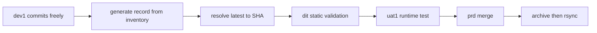

<!-- TermiteTowers Continuous Code Management Header TEMPLATE --- %ccm_git_header_start:  % -->
<!-- %ccm_git_repo: TermiteTowers % -->
<!-- %ccm_git_branch: dev1 % -->
<!-- %ccm_git_path: docs/design/promotion-model.md % -->
<!-- %ccm_git_object_id: docs/design/promotion-model.md@204 % -->
<!-- %ccm_git_commit_date: 2026-11-09 14:19:49 -0500 % -->
<!-- %ccm_git_commit_author: mpegg % -->
<!-- %ccm_git_commit_message: nginx: retire tag-viewer symlinks into AnalAcres; document the publish gap % -->
<!-- TermiteTowers Continuous Code Management Header TEMPLATE --- %ccm_git_header_end:  % -->
<!-- %git_commit_history: 2026-11-09 mpegg promotion: manifest inventory, record generator, deploy archive/restore -->
# Promotion model — manifest-based promotion

**Status:** design agreed, nothing implemented. This document is the reference the
implementation is measured against, and the place where accepted debts are recorded
so they stop being rediscovered.

**Scope:** how a change reaches `prd` in this repository. Not how services are
installed, not how secrets are managed, not how a runner is registered — those
have their own documents.

`docs/` is outside `docs_dir: wiki`, so this page is tracked and CCM-managed but
never published.

---

## 1. Why not branches

Feature branches were considered and rejected. The reasons are specific, not
philosophical:

- **Commits on `dev1` are not atomic.** They are named `zoo.261109`. `git
  cherry-pick` promotes whole commits, so it can only work if every commit is a
  coherent, reviewable unit.
- **`git merge dev1` promotes everything since the merge base**, which on a
  working branch is unusable.
- The unit of promotion here is **a chosen set of paths at chosen versions**, and
  the artifact that expresses it is a manifest.

The capability this buys that branch-merge promotion cannot: **the promotion is
replayable**. Rollback is "apply record N-1", not "reconstruct what prod looked
like last Tuesday".

The door is one-way. Once `prd` never merges from `dev1`, a later merge is
unresolvable. Merges, rebases and `git checkout dev1 -- <path>` are therefore
**blocked on `prd`**, not merely discouraged: the promote record is the only
evidence that content on `prd` was deliberate.

---

## 2. The model

- An **inventory** declares which paths an app owns, and where each one lands per
  tier. Leaf paths only. Slow-changing. Reviewed when it changes.
- A **promote record** is generated per promotion from the inventory plus a source
  commit. It is small, pins every operation to a concrete commit and blob, and it
  is reviewed every time.
- **Ownership defines the domain, so completeness is checkable.** For owned paths:
  present at source and content differs ⇒ copy; absent at source and present on the
  target ⇒ delete. Nothing can be silently omitted *within* the ownership domain.
- The record is the **audit artifact**. Not the git history of `prd`, not the
  `dit` tree's history, not the CCM history trail.

---

## 3. Tiers and reset policy

Rungs differ by **reset policy**, not by seniority:

| Tier | Reset policy | Purpose | History is |
|---|---|---|---|
| `dev1` | never reset, deliberately messy | the work | the work |
| `dit` | regenerated from resolved `latest` on every promote | static validation: does the tree resolve | worthless as a record |
| `uat1` | accumulated, promoted into | the runtime tier; services actually start | QA/smoke surface |
| `prd` | accumulated | production | the promote records |

`dit` is a **static** rung. It needs no services, therefore no secrets, therefore
it is not blocked by the secrets prerequisite that `uat1` is. Its checks are: the
record applies cleanly, the inventory resolves, dependent files exist, config files
parse, the residual report is empty.

`sit` and `uat` are **test phases**, not environments. Do not add an environment
for them.

Adding an integration rung (`int`/`dit`) that aggregates multiple dev branches is
**deferred** until a second dev branch exists. The inventory schema already
supports it, because every record entry carries its own source ref and commit.

Because `dit` is regenerated, two rebuilds of identical content produce **different
commits with identical trees**. Any "did anything change" test must therefore be
content-based, never commit-identity-based.

---

## 4. Artifacts

### 4.1 Inventory

One line per owned path, always a leaf file. Never a directory, never a glob, never
an exclude pattern — an exclusion would be an implicit unbounded delete.

```
src/path/in/repo          ->  dst/path/in/tier
infra/docker/nextcloud-dev1.yml -> infra/docker/nextcloud-dev1.yml
```

Rules:

- **Enumerated from `git ls-tree -r --name-only <ref>`, never from the filesystem.**
  A disk walk follows symlinks and silently pulls in everything reachable through
  them, including trees that contain secrets.
- For an app with 200+ files this is 200+ lines. That is deliberate: it makes
  ownership explicit, makes decommissioning a list edit, and makes
  cross-manifest destination collisions statically checkable.

### 4.2 Promote record

```yaml
record_version: 1
id: 2026-11-09T17-25-uat1-to-prd
app: termitetowers-core
inventory_ref: <sha of the inventory file>
source_ref: uat1
source_commit: 07c638fcfb4804b40c226db94358725a8b6ef636
applies_to: prd
generated_by: engine@<sha>
entries:
  - op: copy
    src: infra/docker/nextcloud-dev1.yml
    dst: infra/docker/nextcloud-dev1.yml
    blob: 1fc9b67eb0727868e13ad478eb85fc51b30de794
  - op: delete
    dst: scripts/retired-thing.sh
```

### 4.3 Pinning rules

- **`latest` is an authoring-time alias and is resolved to a concrete SHA at
  generate time.** A committed record never contains `latest`. A record that
  resolves at apply time invalidates the dry run, breaks replay, and breaks
  rollback.
- Every `copy` entry pins the source commit **and** the source blob. Per-entry
  pins, not one global pin — this is what makes multi-source fan-in expressible
  later.
- Cascading overrides must record their **resolved effective entry**, not the
  pattern that produced it. Otherwise the artifact no longer states what lands.

### 4.4 Derivation from ownership

```
owned      = inventory paths mapped to the destination tier
at_source  = owned paths whose source path exists at source_commit
copy       = at_source AND destination content differs
delete     = owned AND NOT at_source AND destination has the path
```

### 4.5 Residual report

`source tree` minus `inventory` minus a declared ignore list. This is the
**inventory-staleness alarm**: it answers "are there source files this app should
own but does not list". It is not a per-promote checklist, and it must stay short
enough to be read — which is what the ignore list is for.

### 4.6 Validation rules

- Leaf paths only; no directories, no globs.
- **At most one entry per destination path within a record**, so a
  replace-with-delete cannot be interpreted two ways by resolution order.
- **Destination-path uniqueness across all inventories** for a tier, so two apps
  claiming one destination fail at rest.
- **Case-collision check** for case-insensitive destinations: a delete naming
  `Foo.yml` must not be able to remove `foo.yml`.
- A path whose git mode is `120000` (symlink) is **not promotable** unless
  explicitly allowlisted, and absolute-path link targets are rejected.

---

## 5. Flow



---

## 6. Deploy-side contract

Anchored on the two existing workflows: [`deploy-dev1.yml`](../.github/workflows/deploy-dev1.yml)
and [`deploy-prd.yml`](../.github/workflows/deploy-prd.yml).

### 6.1 Deployed state markers

The deploy writes two files into `/srv/<tier>/` — **outside the run area**, not
inside it. Inside, `.deployed-manifest` would be an untracked file, which violates
the authorised-untracked invariant and forces that invariant to carve out an
exception for the one file whose job is to describe exceptions.

- `.deployed-manifest` — a sorted listing of `TYPE<TAB>VALUE<TAB>PATH` for every
  deployed file (`F`, sha256) and symlink (`L`, target string)
- `.deployed-commit` — the commit the deploy came from, informational for humans

**Implementation note, and a correction to this document's first draft:** drift is
computed against the hash manifest, **not** against the git tree of
`.deployed-commit`. Two reasons make the git form unworkable here:

- `actions/checkout@v4` is a depth-1 single-ref clone, so the previously deployed
  commit is not present as an object in the deploy job.
- The run area is not guaranteed to have been produced by a checkout at all, in
  which case there is no git relation to diff against.

The hash manifest is both the drift baseline and the **definition of authorised
content**, which is what makes an unauthorised file distinguishable from a
legitimate delete.

### 6.2 Archive step

Derived from the markers, and implemented in `scripts/deploy/tt-deploy-archive.sh`:

```
ADDED     in run area, absent from .deployed-manifest   -> purged by rsync --delete
MODIFIED  in both, content differs                      -> overwritten by rsync
MISSING   in .deployed-manifest, absent from disk       -> restored by rsync

archive = ADDED UNION MODIFIED          (skip when empty)
MISSING is reported, never archived      (there are no bytes to preserve)
```

Because the deploy replaces the run area wholesale, `ADDED UNION MODIFIED` *is* the
destroyed set — the overwrite/purge distinction is carried in the report rather than
computed separately.

Conditions:

- It is the step **immediately before** `Synchronize approved revision`. In
  `deploy-prd.yml` rsync is step 1 and the dependency step after it is
  expected-red by design, so the archive must run first and must not depend on
  later steps.
- **Fatal on failure.** If the archive cannot be written for a path that is about
  to be purged, the deploy aborts.
- **Skipped when empty.** No drift on a destroyed path ⇒ nothing to archive.
- It is a separate prior step, not a side effect of the copy, because the purge
  happens *during* the copy pass.

### 6.3 Authorised-untracked invariant

The rule is not "no untracked files", it is **"untracked minus the exclusion list
must be empty"**, asserted before the purge. TT's existing exclusions are visible
in the deploy command: `.env` and `.venv`. Anything outside the exclusion list is
an alarm.

### 6.4 Restore

`restore <archive-id> <host> <path>` must exist as a scripted command and be
**exercised at least once against a real run area**. An archive with no tested
restore is not a recovery path.

---

## 7. CCM header semantics — frozen origin

Promoted bytes keep the header they had at the origin commit. The header is a
**frozen stamp of origin**, not a claim about the current branch.

- `%ccm_git_branch`, `%ccm_git_repo`, `%ccm_git_path` are **origin-relative**. A
  promoted file therefore disagrees with the branch it sits on, and that is
  correct. `git_path` does not track a remapped destination path — do not
  "reconcile" it.
- `git_blob_sha`, `file_eol`, `size` describe the **origin blob**, not the current
  file. **Do not build any check that verifies the current file against them.**
- `object_id` contains a branch-relative commit count, so it will differ between
  tiers by design. Never assert on a full header.
- The history trail grows on each promotion and is bounded by `CCM_HISTORY_MAX`.
  It is **not** the audit record. The promote record is.

**Precondition:** a promote commit is never made in a clone with hooks installed.
Today hooks exist only in the workstation clone. The trigger to revisit is the
engine gaining its own workarea hooks, or a promote being committed by hand from
the workstation clone. The guard to add at that point is a **source-branch
allowlist** inside the hooks — not a per-file marker (whole-file grep, and it
would skip secret scanning), and not `--no-verify` (which does not stop
`post-commit`, the hook that amends and appends history).

---

## 8. Delete semantics — blind, by decision

`DELETE` is file-based, because a directory delete is an unbounded destructive set
dressed as one line.

Delete is **blind**: it names the destination path and removes it, with no expected
blob pin. Rationale:

- The git half is never at risk — the deleted blob remains in the parent commit on
  the target branch.
- The only unrecoverable case is **run-area bytes that had drifted from git** and
  are about to be purged — which is exactly the set the archive captures.
- Deletes are rare enough that the guarded form (expected-blob precondition) is not
  worth the extra field.

Two mechanics it still needs:

- **Idempotent:** already-absent is success, so replay and rollback work.
- Section 4.6 rules apply: one entry per destination path, case-collision check.

---

## 9. Privileged paths

Some paths act by existing rather than by content. In this repository:

- `.github/workflows/*.yml` — a workflow on the target branch fires on the next push
  to that branch. Workflows are read from the pushed ref, so an orphan or a stale
  workflow on `prd` is a live trigger, not dead weight.
- `infra/systemd/*.service` — an installed unit is a running service.
- `infra/nginx/sites-available/*` — an enabled site is a listener.
- `infra/logrotate/logrotate.d/*` — picked up on the next rotation, silently.

Rule: these require an explicit second approval in the promote record, because
promoting one can redeploy, restart or expose something with no content change.

---

## 10. Symlinks

`wiki/` links whole trees into `infra/`, one of which reaches
`infra/docker/env/*.env`. This is why the MkDocs publishing filter is restrictive.

- Enumerate from **git**, never the filesystem (see 4.1).
- Copy must preserve link-ness. `git restore` and `rsync -a` do. **Robocopy `/MIR`
  follows junctions and copies their contents** — on a Windows destination a
  promoted link expands into a real tree, and if it points at a secrets directory
  the run area and archive both receive secrets.
- Absolute-path link targets are untracked runtime dependencies and are rejected at
  resolve time.

---

## 11. Audit and rollback

- The **promote record** is the audit artifact. `dit` is rebuilt, so its history is
  not; `prd`'s history shows promotes but not intent.
- The record id is **echoed into the target commit message** (or committed into the
  target branch alongside the payload), so the target repo is self-describing
  without the engine.
- Rollback is **replaying record N-1**. Keep the last N records alongside the
  inventory.
- Tag ordering: commit → let `post-commit` amend → **then** tag. A tag taken before
  the amend points at an orphaned commit.

---

## 12. Decisions

| # | Decision | Rationale | Accepted debt |
|---|---|---|---|
| D1 | Manifest promotion **replaces** the current PR-merge-into-`prd` flow | non-atomic commits; partial promotion; replayable rollback; ground truth shows `prd` is 24 behind with zero divergent content, so the switch costs nothing to make | one-way door; no cross-tier bisect |
| D2 | Inventory + promote record as two artifacts | 200-line review problem solved without changing the apply mechanism | two files to keep in step |
| D3 | Leaf paths only, no directories or globs | determinism and reviewability | verbosity |
| D4 | `latest` resolved at generate time | reproducibility, meaningful dry run, replay | authoring step |
| D5 | Per-entry source pin | fan-in from multiple dev branches later | slightly larger records |
| D6 | `dit` as a static rung | completeness catch-net with no services, so no secrets prerequisite | one more branch |
| D7 | Blind file-based `DELETE` | git retains the blob; archive encloses the drifted case | a drifted target file can be removed without an abort |
| D8 | Frozen-origin CCM headers | provenance survives promotion; prd review diff stays clean | headers disagree with their branch; hooks must never run on targets |
| D9 | Hooks left unguarded for now | hooks exist only in the workstation clone | a written precondition that must be checked before the engine gains hooks |
| D10 | Fourth repo as the engine, cross-repo keys | same design as the proven work model; one audit log | credential blast radius; single point of failure at promote time |
| D11 | Deploy triggers on target-branch push, not from the engine | a dead engine does not block an in-flight deploy | promote and deploy are separate events to reason about |
| D12 | Archive only what the apply would destroy | cheap, precise, and doubles as the drift report | needs the state markers and a tested restore |
| D13 | `uat1` may accept fixes | solo operator; it is the only pre-prod runtime gate | record pins `uat1`; drift report is the back-port reminder |
| D14 | Tier bleed in filenames accepted for now | `prd` currently runs the dev1-named tree; renaming is a separate cleanup | promotion to a *meaningful* prd is blocked on that cleanup |
| D15 | PRs into `prd` are closed as a practice | `prd` mutates only via the engine, so the promote record is the only evidence of intent | no GitHub-native review surface on `prd`; review lives in the engine |
| D16 | Drift baseline is a hash manifest, not a git tree | depth-1 checkout, and a run area that may not come from a checkout at all | a second file to keep in step with `.deployed-commit` |
| D17 | `prd1` and `main` are retired | `prd1` is strictly behind `prd`; `main` is strictly behind with no workflows yet is `origin/HEAD` | none |

---

## 13. Pitfall register

| # | Pitfall | Status |
|---|---|---|
| P1 | Purge destroys drifted run-area bytes | closed: archive before rsync, per-path, fatal, plus tested restore |
| P2 | Whole-file copy carries the tier | accepted debt, D14 |
| P3 | Undetected `prd` drift | closed: same computation as P1 |
| P4 | Forgetting is silent in a transfer spec | closed: ownership-derived add/modify/delete; residual report |
| P5 | Directory entries make the manifest unbounded | closed: leaf paths only |
| P6 | Fixes made below the promotion line | closed: D13 |
| P7 | Divergence forever | closed: one-way door enforced |
| P8 | A validation rung that proves nothing | closed: `dit` is static, `uat1` is the runtime gate |
| P9 | Promoted subset not self-consistent | closed by `dit` static validation |
| P10 | Losing the change as a revertable unit | closed: one record is one unit |
| P11 | Target never forgets; behaviour-bearing orphans | closed: file `DELETE`, plus section 9 approvals |
| P12 | Symlink dereference leaks secret trees | closed: enumerate from git, reject absolute targets, no `120000` promotion |
| P13 | Non-idempotent apply | closed: content-based comparison; already-absent delete is success |
| P14 | Credential blast radius | open: per-destination fine-grained tokens; engine protected as strictly as `prd` |
| P15 | Workarea concurrency and residue | open: lock per repo+branch; verify checkout `clean` is intact |
| P16 | Engine unavailable looks like nothing to promote | open: auth failures must be loud, never an empty record |
| P17 | Audit trail split across two repos | closed: record id echoed into the target commit message |

---

## 14. Prerequisites and open items

1. ~~**Ground truth.**~~ **Established.** `origin/prd` is 24 behind `dev1` and 3
   ahead, and all three of its unique commits are merge commits (PRs #1–#3 from
   `dev1`) that introduce no content of their own. **There is no prd-only content**,
   so the prd-only allowlist starts empty and the first promotion can reproduce
   current `prd` content exactly from `dev1`. `origin/prd1` is strictly behind
   `origin/prd` — 0 commits that `prd` lacks — so it is a stale duplicate.
   `origin/main` is strictly behind `prd`, carries no workflows, and is
   `origin/HEAD`: the GitHub default branch points at a stale ancestor, which is
   how a PR gets opened against the wrong base. `deploy-prd.yml` exists on `prd`;
   `deploy-dev1.yml` exists only on `dev1`.
2. **`uat1` secrets prerequisite.** `.gitignore` excludes `infra/docker/env/*.env`,
   so no checkout has secrets. Until secrets live in one root outside every
   checkout and are symlinked in, `uat1` can receive files but cannot run services.
   `dit` is not blocked by this.
3. **Tier naming cleanup.** `prd` currently runs the dev1-named tree. Without the
   cleanup, a promotion to `prd` has no target that differs from the source, so it
   proves nothing.
4. **Engine scope.** Per-destination tokens, engine repo protected as strictly as
   `prd`, one workarea per repo per branch, loud auth failures, record id in the
   target commit message.
5. **Two absolute-path symlinks exist on `dev1` and are live today.** Found by the
   inventory generator, which refuses them:

   ```
   infra/nginx/www/tag-viewer/inject.js       -> /home/mpegg-adm/source/AnalAcres/tag-viewer/inject.js
   infra/nginx/www/tag-viewer/tag-viewer.html -> /home/mpegg-adm/source/AnalAcres/tag-viewer/tag-viewer.html
   ```

   **Resolved 2026-11-09: both links removed.** They were read by nothing —
   `grep -rn "nginx/www/tag-viewer" infra/` returns no hits, because nginx serves that
   URL from `alias /var/www/tag-viewer/`. They were a workstation editing convenience
   that had drifted away from how the asset is actually served. A directory README now
   records the real contract.

   That investigation exposed a **separate, live defect**: `/var/www/tag-viewer/` is
   populated by hand and is stale. The served `inject.js` is 8132 bytes dated 4 July
   while the AnalAcres source is 9258 bytes dated 8 July, and AnalAcres's
   `deploy-prd.yml` rsyncs only to `/srv/prd/aa`, so **nothing publishes these assets**.
   The symlinks were covering for a missing publish step.

   Intended end state: AnalAcres publishes `tag-viewer/` from its own deploy into
   `/srv/<tier>/www/tag-viewer`, TermiteTowers aliases that path, and neither repo
   promotes the other's bytes. This is the first concrete case of the rule that a repo
   owns its vhost but not another repo's assets.

---

## 15. Build order

Measured in dependency, not duration.

1. ~~Ground truth on `prd` versus `dev1`.~~ Done, see section 14.
2. ~~Deploy-side: marker, archive step, restore script.~~ Done, see section 16.
3. Inventory schema and generator, enumerated from git.
4. Promote record generator, with `latest` resolution and ownership-derived deletes.
5. Validation checks: leaf-only, one entry per destination, cross-manifest
   uniqueness, case collisions, residual report.
6. `dit` static validation workflow.
7. `uat1` workflow, after the secrets prerequisite.
8. `prd` apply step: pre-deploy snapshot, required reviewer, tag after amend.
9. Engine repo and credentials.

---

## 16. Implemented so far

| Artefact | What it does | Verified |
|---|---|---|
| `scripts/deploy/tt-deploy-archive.sh` | classifies run-area drift, archives what the deploy would destroy, skips when empty, refuses to run blind on a non-empty area with no baseline | sandbox: 2 added, 1 modified, 1 missing; archived exactly those 3 |
| `scripts/deploy/tt-deploy-record.sh` | writes `.deployed-manifest` and `.deployed-commit` atomically, outside the run area | sandbox: manifest round-trips; a second archive run reports no drift and skips |
| `scripts/deploy/tt-deploy-restore.sh` | verifies every payload against its recorded hash, then restores | sandbox: byte-exact restore of a hand-edited file and an unauthorised file after a real `rsync --delete` purged them |
| both deploy workflows | archive before rsync, record after, archive step fatal on failure | **not yet run on a real runner** |

The first recorded deploy needs the repo variable `TT_ARCHIVE_BOOTSTRAP=1`, because the
script refuses a non-empty run area that has no baseline: in that state every existing
file would be classified as unauthorised and purged without being archived. Remove the
variable immediately after that deploy.

Still unimplemented, in build order: inventory generator, promote record generator, the
validation checks, `dit` static validation, `uat1`, the engine, and the `prd` apply step.
