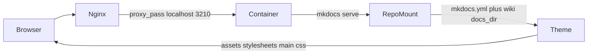

<!-- TermiteTowers Continuous Code Management Header TEMPLATE --- %ccm_git_header_start:  % -->
<!-- %ccm_git_repo: TermiteTowers % -->
<!-- %ccm_git_branch: dev1 % -->
<!-- %ccm_git_path: plans/mkdocs-revamp.md % -->
<!-- %ccm_git_object_id: plans/mkdocs-revamp.md@195 % -->
<!-- %ccm_git_commit_date: 2026-10-29 21:42:03 -0400 % -->
<!-- %ccm_git_commit_author: mpegg % -->
<!-- %ccm_git_commit_message: mkdocs updates % -->
<!-- TermiteTowers Continuous Code Management Header TEMPLATE --- %ccm_git_header_end:  % -->
# MkDocs Site Revamp Plan

## Reported problem

`https://docs.termitetowers.ca` renders as plain black text on white with no colored
header, no styled sidebar, no search box. The theme is Material, so this is not a
theme-choice problem.

## What is already correct

- `mkdocs.yml` sets `theme.name: material` with light/dark palettes.
- `docs.termitetowers.ca` is enabled in `/etc/nginx/sites-enabled` and proxies to
  `localhost:3210`.
- The container publishes `0.0.0.0:3210:8000` and runs `serve --dev-addr=0.0.0.0:8000`.

## Delivery path



Styling is absent because the last hop is failing. Either the document returned for `/`
is not a themed page, or the asset URLs inside it do not resolve.

## Ranked hypotheses

1. **No `wiki/index.md`.** `docs_dir` is `wiki`; the only root landing file is
   `README.md`, which MkDocs publishes at `/README/`, not `/`. A request for `/`
   therefore has no page, and MkDocs answers with a bare not-found document: plain
   black text on white, no chrome. This matches the reported symptom exactly.
2. **`exclude_docs` is dropping nested pages and the stylesheet.** The pattern is
   `*` then `!*.md`, `!**/*.md`, `!stylesheets/**`. `exclude_docs` uses gitignore
   wildmatch semantics, where a file cannot be re-included if a parent directory is
   still excluded. `*` matches directories, so the negations do not reliably re-admit
   `hams/docs/*.md`, `ai-models/*.md` or `stylesheets/extra.css`. This leaves
   `extra.css` at 404 and hides whole sections of the nav.
3. **Dev server rather than a built site.** `serve` is not a production server, uses
   live-reload machinery, and Material disables instant navigation under it. The
   mounted `site_dir` at `/mnt/ai_storage/mkdocs/site` is empty, so the intended
   build-and-serve layout was never finished.
4. **Contradictory feature flags.** `navigation.expand` has no effect alongside
   `navigation.sections`, and `navigation.tabs` combined with auto-discovered nav puts
   every root page into the top bar.

## Step 1: Diagnose before changing anything

Run on the host and keep the output:

```bash
curl -sI  https://docs.termitetowers.ca/
curl -s   https://docs.termitetowers.ca/ | head -40
curl -s   https://docs.termitetowers.ca/ | grep -oE 'href="[^"]+\.css[^"]*"'
curl -sI  https://docs.termitetowers.ca/assets/stylesheets/main.*.css   # use real hash from previous line
curl -sI  https://docs.termitetowers.ca/stylesheets/extra.css
curl -sI  http://localhost:3210/
docker logs --tail 80 mkdocs_app-dev1
```

Branch on the result:

- Status 404 on `/` with a bare body: hypothesis 1, create the homepage.
- Status 200 with `main.*.css` returning 404: hypothesis 2 or 3, fix asset delivery.
- 502 from nginx: the container is not up, restart it and re-check.
- Everything 200 and styled at `localhost:3210` but not through the domain: the fault is
  in nginx, inspect the enabled symlink target for `docs`.

## Step 2: Choose the delivery model

Preferred: build the site and serve it statically.

```bash
docker run --rm -v /home/mpegg-adm/source/TermiteTowers:/docs \
  squidfunk/mkdocs-material:latest build
```

Then point the vhost at the built tree, or keep a compose service that runs `build`
with `--watch` instead of `serve`. This removes live-reload from the public path and
makes `/mnt/ai_storage/mkdocs/site` meaningful instead of an empty mount.

If `serve` is kept, restrict it to the LAN and document that the domain is dev-only.

## Step 3: Homepage

Create `wiki/index.md` as the landing page: what this site is, a grid of links to the
five or six entry points, and the service table. Move the useful content out of
`wiki/README.md` and delete the claim that the pages are ready to import into Wiki.js,
which has been false since the MkDocs cutover. `README.md` can become a one-line
pointer or be removed once nothing links to it.

## Step 4: Exclusions that actually work

Replace the fragile `*` plus negations with explicit directory re-inclusion, keeping the
secret-exclusion guarantee intact. The rule to preserve: nothing except `*.md` and
`stylesheets/**` is ever published, so `infra/docker/env/*.env`,
`hams/esphome/secrets.yaml` and MCP `config.json` cannot leak.

Shape to target:

```yaml
exclude_docs: |
  !*/
  !**/*.md
  !stylesheets/**
  *
```

Then prove it with a strict build and confirm the warnings list no missing pages:

```bash
docker run --rm -v /home/mpegg-adm/source/TermiteTowers:/docs \
  squidfunk/mkdocs-material:latest build --strict
```

`--strict` fails on any excluded-but-linked page, which is the check that matters.

## Step 5: Navigation

With roughly 37 root-level pages plus `ai-models/`, `hams/`, `infra/`,
`git-automation/`, and `diff-automation` trees, auto-discovery is unusable. Write an
explicit `nav:` with about six top-level sections and keep `navigation.tabs` so each
becomes a tab with a readable name:

| Tab | Contents |
|---|---|
| Overview | index, ports, domains, device naming, critical infrastructure |
| Infrastructure | IP allocation, paths and symlinks, env variables, backup strategy |
| Docker | how-to guides, compose conventions, docker networks, nginx |
| Runbooks | all `runbook-*.md` pages |
| Home Assistant | `hams/docs/*` |
| AI and Agents | `ai-models/*`, MCP and model docs, agent-index |
| Git Automation | `git-automation/*`, CCM header rules |

## Step 6: Theme configuration

- Drop `navigation.expand` or `navigation.sections`, whichever the nav shape does not
  need; keep `navigation.tabs`, `navigation.sections`, `navigation.top`,
  `navigation.tracking`.
- Treat `navigation.instant` as incompatible with live reload; keep it only if the site
  is served as a build.
- Add `theme.language`, explicit `font` (text and code), a `logo`, and a `favicon` so
  the header is identifiable rather than the default blank bar.
- Add `theme.icon` for a repository link and set a favicon derived from the existing
  asset set.
- Consider `custom_dir: overrides` only if the homepage needs a hero or grid layout
  beyond stock Markdown.

## Step 7: Stylesheet

`wiki/stylesheets/extra.css` currently sets `.md-grid` to `max-width: 98%` and
`.md-typeset` to `100%`, both `!important`, which destroys Material's centred 61rem
reading column and stretches prose and tables to the viewport edge. The scrollbar rules
target `table::-webkit-scrollbar`, but Material scrolls tables through a
`.md-typeset__scrollwrap` wrapper, so they never apply.

Rewrite as: keep the default content width, widen only for tables via the actual scroll
wrapper, add modest padding, and theme the scrollbar on the wrapper. Limit `!important`
to the one place it is genuinely needed.

## Step 8: Documentation accuracy

Update after the changes:

- `wiki/runbook-mkdocs.md`: the Navigation Structure section documents a `nav:` that
  was removed, and the Usage section describes dev-server behavior only.
- `wiki/mkdocs-deployment-checklist.md`: reflects the old symlink and www layout.
- `wiki/tech-context.md` and `wiki/agent-index.md`: both describe the 3210 dev server
  as the serving method.
- `wiki/README.md`: links five pages that do not exist (`storage-model.md`,
  `runbook-whisper.md`, `runbook-wikijs.md`, `runbook-uptime-kuma.md`,
  `vision-hal-enterprise-computer.md`).

## Step 9: Verification

- `curl -sI https://docs.termitetowers.ca/` is 200 and the body contains `md-header`.
- The `main.*.css` request is 200 with `content-type: text/css`.
- Toggle light and dark and confirm both palettes render.
- Load a page containing a Mermaid block and confirm the diagram draws.
- Search returns results and highlights.
- A page under `hams/docs/` and one root runbook both load, proving nested pages are no
  longer excluded.
