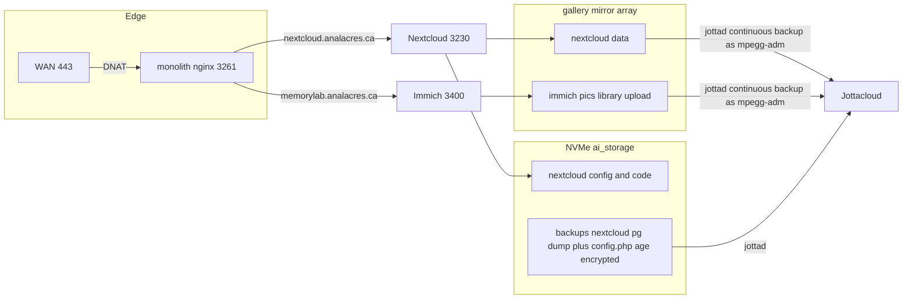

<!-- TermiteTowers Continuous Code Management Header TEMPLATE --- %ccm_git_header_start:  % -->
<!-- %ccm_git_repo: TermiteTowers % -->
<!-- %ccm_git_branch: dev1 % -->
<!-- %ccm_git_path: plans/nextcloud-storage-and-jotta.md % -->
<!-- %ccm_git_object_id: plans/nextcloud-storage-and-jotta.md@200 % -->
<!-- %ccm_git_commit_date: 2026-11-09 10:16:57 -0500 % -->
<!-- %ccm_git_commit_author: mpegg % -->
<!-- %ccm_git_commit_message: zoo.261109 % -->
<!-- TermiteTowers Continuous Code Management Header TEMPLATE --- %ccm_git_header_end:  % -->
# Nextcloud on the gallery array + Jotta coverage for Immich

**Status:** decisions settled, Phase 0 measured 2026-11-08. Hostname is `filebank.analacres.ca`.
Database is its own `nextcloud` database created from the documented Nextcloud statement.
Implementation has not started; Phase 1 requires one privileged step.
**Scope:** promote the throwaway Nextcloud to a real service, put its user data on the
same filesystem as the Immich library, publish it at `filebank.analacres.ca`, and extend
Jotta offsite coverage to Immich photos.

---

## 1. What the investigation found

### 1.1 The Nextcloud that exists today

| Item | State | Source |
| --- | --- | --- |
| Compose | single `nextcloud:latest` container, `3230:80`, three bind mounts under `/mnt/ai_storage/nextcloud/` | [`infra/docker/nextcloud-dev1.yml`](../infra/docker/nextcloud-dev1.yml:28) |
| Env file | **`infra/docker/env/nextcloud.env` is a 0-byte file**; only the `.example` carries values | [`infra/docker/env/nextcloud.env`](../infra/docker/env/nextcloud.env) |
| vhost | `nextcloud.termitetowers.ca` on **443**, cert `termitetowers.ca-0001`, proxy to `127.0.0.1:3230` | [`infra/nginx/sites-available/nextcloud.conf`](../infra/nginx/sites-available/nextcloud.conf:35) |
| Port allocation | 3230, marked complete | [`wiki/ports.md`](../wiki/ports.md:88) |
| Backup | **none** — no script in `infra/backups/scripts/`, no Jotta registration, no runbook | `infra/backups/scripts/` |
| Monitoring | `nextcloud_termitetowers_ca_*` system-status checks already exist | [`hams/docs/hal-context.md`](../hams/docs/hal-context.md:93) |

**Key inference from the live database.** The host Postgres database `nextcloud` exists
and is **7,607 kB** — only 24 kB larger than `template0`. Live counters:

| datname | size | backends | xact_commit | tup_inserted | tup_updated |
| --- | --- | --- | --- | --- | --- |
| ttdb_dev1 | 1612 MB | 4 | 10,615,597 | 5,207,914 | 170,957,862 |
| ttphoto_dev1 | 1161 MB | 0 | 164,624 | 2 | 23 |
| **nextcloud** | **7607 kB** | **0** | 164,378 | **0** | **0** |

A Nextcloud schema install writes thousands of rows into `oc_appconfig`,
`oc_migrations` and `oc_users`. **Zero row inserts ever** means that database was
created by the README's setup step and then never used. Combined with the empty
`.env`, the running instance is almost certainly on **SQLite** inside
`/mnt/ai_storage/nextcloud/data`, which is the default when no `POSTGRES_*` env is
supplied. That is exactly the "play thing" signature.

### 1.2 The Immich side

| Item | Value |
| --- | --- |
| Uploads / library | `/gallery/immich/pics` bind-mounted to `/data` |
| Database data | `/mnt/ai_storage/immich/postgres` on NVMe — correct, Immich forbids the DB on a network FS |
| Extra mounts | `/gallery/shares/mpegg`, `/gallery/shares/dsone` at `/mnt/pmedia/VG/...` |
| Published at | `memorylab.analacres.ca` on the shared TLS listener **3261**, gate-ready but ungated |
| Jotta coverage | **none** — nothing under `/gallery` is in the backup set |

**Documentation gap:** the topology of `/gallery` itself (mirror type, number of disks,
mount options, free space) appears **nowhere** in the repo. [`wiki/backup-strategy.md`](../wiki/backup-strategy.md:31)
still describes `/mnt/ai_storage` and USB rotation only.

### 1.3 How Jotta actually works in this house

Two mechanisms, and they must not be mixed:

| | Continuous backup | Archive |
| --- | --- | --- |
| Command | `jotta-cli add <dir>` then scan | `jotta-cli archive <file> --remote=folder/file` |
| Driver | `jottad` **user** unit running as `mpegg-adm`, hourly scan | one-shot put from a script |
| Lands in | Jotta Backup area | Jotta Archive area |
| Visibility | `jotta-cli status` | `jotta-cli ls archive/...` |
| Precedent | tthealth dumps, thunderbird mail | PhotoArchive HDRI, water-meter images |

**The permissions contract is the failure mode that will bite here.**
`infra/backups/README.md` documents it at length: `jottad` uploads as `mpegg-adm`, who
is in `tt-ai-storage` but **not** in `tt-backup`. A file that is not group
`tt-ai-storage` and readable by `mpegg-adm` is silently never uploaded — `jotta-cli
status` just sits on "N files have not been backed up" with no error in
`~/.jottad/jottabackup.log`. Immich writes its own files with its own ownership, so
**this must be verified before `jotta-cli add`**, not after.

### 1.4 Gating precedent

[`wiki/runbook-authelia.md`](../wiki/runbook-authelia.md:63) establishes the rule: a
browser redirect gate cannot protect a client that authenticates per-request with its
own token, so API prefixes are exempt. Immich exempts `/api/`, AudioBookshelf
`/api/` + `/socket.io/`, Navidrome `/rest/`. Nextcloud has more exempt surface than
any of them — see §3.3.

---

## 2. Target shape



Two deliberately separate backup layers, because they fail differently:

1. **Bulk user data** (Nextcloud files, Immich originals) → continuous backup of the
   gallery array. Large, append-mostly, no encryption layer of its own.
2. **Metadata and configuration** (Postgres dump, `config.php`) → the existing
   encrypted pattern: `pg_dump -Fc | age -R` into `/mnt/ai_storage/backups/<app>/`,
   replicated by `jottad`. Small, must be encrypted, written by a least-privilege
   account.

Losing layer 1 costs files. Losing layer 2 loses the ability to *find* the files. Both
are needed.

---

## 3. Design decisions

### D1 — Split the Nextcloud data dir onto the array

Keep application code and `config/` on NVMe; move only `datadirectory` to the array.

```yaml
volumes:
  - /mnt/ai_storage/nextcloud/data:/var/www/html            # code, image-managed, churns on upgrade
  - /mnt/ai_storage/nextcloud/config:/var/www/html/config    # instance config - small, snapshotted
  - /mnt/ai_storage/nextcloud/custom_apps:/var/www/html/custom_apps
  - /gallery/nextcloud/data:/var/www/html/data               # user data, bulk
```

Rationale: `/var/www/html` is rewritten by every image upgrade and belongs with
`config/` and the DB dump for restore-together. User files never belong in a cloud
backup mixed with code. This also keeps the array's contents exactly equal to
"irreplaceable bytes", which makes Jotta coverage auditable.

Ownership: follow the house convention `2001:1006` (`storage-svc:tt-ai-storage`,
[`wiki/paths-and-symlinks.md`](../wiki/paths-and-symlinks.md:31)) so `jottad` can read
it by group membership — the permissions contract from §1.3 then holds by
construction rather than by accident. Verify a real write as the container user before
trusting it.

### D2 — Database: clean rebuild against host Postgres (decided)

**Owner decision: nothing in the current instance is worth keeping.** So there is no
migration and no `occ db:convert-type` run. The instance is rebuilt from scratch
against the host Postgres `nextcloud` database, which is already provisioned
([`README.nextcloud.md`](../infra/docker/README.nextcloud.md:36)) and currently
empty — its virgin state from §1.1 becomes a feature rather than an anomaly.

Consequences, all of which simplify the work:

- No downtime window to negotiate, no export/import, no `files:scan` of existing data.
- The data dir is created **directly** on the array, so §D1's split is the initial
  state rather than a later move.
- The old SQLite file under `/mnt/ai_storage/nextcloud/data` is disposable. It should
  still be **measured and noted before deletion**, so the decision is provable rather
  than assumed, then archived or removed.
- The empty [`infra/docker/env/nextcloud.env`](../infra/docker/env/nextcloud.env) must be
  populated with real `POSTGRES_*` values *before* the first container start, since
  that first start is what creates the schema. Getting this wrong silently recreates
  the current situation: a SQLite instance that looks fine.
- No other service depends on the old instance's identity, so the admin account and
  instance secret are generated once, fresh, with no migration of either.

### D3 — Hostname and vhost

`nextcloud.analacres.ca` on the shared `listen 3261 ssl` listener, matching
[`wiki/domains.md`](../wiki/domains.md:70). Cert per host through the GoDaddy DNS-01
hooks. Backend is `127.0.0.1:3230` because the container runs on monolith — note the
analacres family splits across hosts (`memorylab` is local, `wordbank`/`soundbank` are
`192.168.4.63`), so the vhost does not inherit a backend.

Required proxy/Nextcloud settings, or sync clients will misbehave:

- `client_max_body_size` large (16G as today), `proxy_request_buffering off`
- `overwritehost=nextcloud.analacres.ca`, `overwriteprotocol=https`,
  `overwrite.cli.url`
- `trusted_domains` includes both `nextcloud.analacres.ca` and the old
  `nextcloud.termitetowers.ca`
- trusted proxy handling for `X-Forwarded-For`
- keep the existing `termitetowers.ca` vhost as a redirect rather than deleting it

### D4 — The Authelia gate is genuinely awkward for Nextcloud

Recommend **ungated at first**, matching the `pics` precedent, and revisit after
Authelia Phase 2. Reasons:

1. Nextcloud has its own users, app passwords and a login page. Gating `/` at Authelia
   yields a double login unless the two identity stores are federated, which is out of
   scope.
2. A gated `/` breaks anything that lands on a Nextcloud URL directly — public share
   links (`/public.php/`) would demand an Authelia session from a recipient who has no
   account.
3. If it *is* gated later, the exempt set is larger than any existing vhost:
   `/remote.php/` (WebDAV + app passwords), `/public.php/` (share links), `/ocs/`,
   `/status.php`, `/index.php/login`, `/login`, `/core/`, `/apps/theming/`,
   `/dist/`. Getting this list wrong breaks desktop sync in a way that looks like a
   network fault.

The vhost should still include `tt-gate-location.conf` and `tt-gate.conf` so it is
*gate-ready* with no vhost edit later, exactly as the other three are.

### D5 — Jotta scope for Immich: send originals, exclude derivable bytes

**Measured, see [`docs/investigations/nextcloud-and-gallery-state.md`](../docs/investigations/nextcloud-and-gallery-state.md).**
The library is 69 G, of which only **19 G** is irreplaceable — originals live in
`upload/`, not `library/`, which is empty.

| Path under `/gallery/immich/pics` | Jotta | Size | Why |
| --- | --- | --- | --- |
| `upload/` | yes | **19 G** | original assets, irreplaceable |
| `library/` | yes | 1 K | currently empty, but this is where Immich may place assets later |
| `profile/` | yes | 1 K | small |
| `backups/` | **decide** | 1.9 G | Immich's own DB dumps — see below |
| `thumbs/` | **no** | 11 G | regenerable thumbnails |
| `encoded-video/` | **no** | 38 G | regenerable transcodes |

**Correction to the earlier draft:** `jotta-cli ignores` **does** exist, so the
mechanism is not an enumeration of leaf folders. Add the single root and exclude the
derivative trees by pattern:

```bash
jotta-cli add /gallery/immich/pics
jotta-cli ignores add --pattern 'thumbs'         --backup pics
jotta-cli ignores add --pattern 'encoded-video'  --backup pics
jotta-cli ignores test  --pattern 'thumbs' --path thumbs/ab/cd/xyz.jpg   # verify before scanning
```

Patterns are relative to the backup root and support `*`/`**`. This is more durable
than leaf-by-leaf adds, which silently miss any subtree Immich introduces in a future
version.

**The `backups/` question is a real decision, not a detail.** Immich already writes 14
rotating daily dumps of 137 MB each. Backing that folder up means a new 137 MB object
uploaded daily, and Jotta retains deleted copies for a grace period, so the cloud copy
grows steadily for a backup that is a *duplicate* of metadata the house pattern already
captures better — encrypted. Recommendation: **ignore `backups/`** and, if desired, add
`backup-immich.sh` alongside the Nextcloud one doing `docker exec immich_postgres-dev1
pg_dump | age -R` into `/mnt/ai_storage/backups/immich`. One consistent, encrypted
metadata path for every app beats two inconsistent ones.

**Encryption note:** the continuous-backup path is not age-encrypted — it is the
Jotta-managed path. Photos therefore go up readable-by-Jotta, which matches the
existing `backup_hdri_jotta.py` precedent but differs from the encrypted DB dumps.
This asymmetry should be stated in the runbook rather than discovered later.

### D6 — Capacity, quota, and the go-live order

Measured: the pool is a **ZFS 2-way mirror of two 4 TB disks with one 4 TB `AVAIL`
spare**, 620 G allocated, **2.91 T available**, 16 % used, last scrub clean.

- **The spare adds no capacity.** It only joins automatically if a mirror member
  fails. Growth means restructuring the pool, which stays a separate project.
- **Create a dedicated `gallery/nextcloud` ZFS dataset**, not a plain directory. It
  gives an independent quota, its own compression setting, and — the real prize —
  independent ZFS snapshots, so Nextcloud data can be rolled back without touching the
  Immich dataset.
- Enforce a Nextcloud **per-user quota** so one runaway sync cannot fill the pool and
  stall Immich writes. The dataset quota is the backstop; the user quota is the normal
  control.
- Alert at 85 % used. Prometheus and Uptime Kuma already exist.
- Backfill order: new assets from cutover first (proves the pipeline), then the 19 G of
  existing originals. No throttling or phasing is needed at this size.
- Add a coverage reconciliation (file count and bytes per top-level folder, local vs
  `jotta-cli ls --json`) mirroring what `install-tt-keys.sh --check` does for the
  keyring. "Nothing in the log" is not proof of upload.

### D7 — Jotta capacity is a non-issue (was: the gating unknown)

`jotta-cli status` reports **`Usage: 11.38TiB / ( Unlimited )`** on device `monolith`.
The account is unlimited, the irreplaceable Immich payload is 19 G, and Nextcloud user
data is 110 MB. **No capacity gate, no tier check, no plan change, and no
new-assets-only compromise is needed.** The earlier draft's D7 is closed.

What replaces it as the sequencing risk is not space but **noise**: a 2.8 G unrotated
`nextcloud.log` sits inside the very directory being backed up, and Immich's 137 MB
daily dumps would add a stream of duplicate metadata objects. Both are handled above and
in D8.

---

## 4. Sequencing intent

Discovery first, because four of the facts above are inferences from the repo and the
database, and only live inspection can confirm them:

1. Container image tag and state, `occ status`, real database backend, data dir size.
2. `lsblk` / `mdadm --detail` / `df` on `/gallery` — mirror type, disk count, spare,
   usable and free space, mount options.
3. Immich subtree sizes, and whether `/gallery` is even readable by `mpegg-adm`.
4. Whether Immich's nightly DB dump job is actually enabled and writing.

Then, in order, for the decided clean rebuild:

1. **Tear down and prepare** — stop and remove the old container, measure and then
   retire the SQLite data dir, drop and recreate the `nextcloud` Postgres database and
   role so the schema starts from zero.
2. **Create the array data dir** at `/gallery/nextcloud/data` with the §D1 ownership,
   and prove a write as the container user before any container is started.
3. **Populate `nextcloud.env`** with real Postgres credentials, then start the stack so
   the *first* boot creates the schema against Postgres. Verify with `occ status` that
   the database backend is Postgres and not SQLite — this is the single check that
   proves the whole rebuild worked.
4. **Publish** — vhost on 3261, certificate, `trusted_domains`, `overwritehost`,
   `overwriteprotocol`, then desktop and mobile client verification.
5. **Guardrails** — per-user quotas and the array-full alert, before real data arrives.
6. **Metadata backup layer** (Postgres dump plus `config.php`, age-encrypted).
7. **Bulk backup layer** (Nextcloud data and Immich originals via `jottad`).
8. **Documentation.**

Two ordering constraints survive from the original draft:

- Nothing in the backup stages starts before the permissions contract is satisfied,
  because a wrongly-permissioned folder fails silently by design. Note the measured
  reality: Immich's files are `root:root 0644`, so `jottad` *can* read them — but by
  world-readability, not by the `tt-ai-storage` group every other backup folder relies
  on. Either accept that explicitly and document it, or align the Immich output
  ownership; do not leave it accidental.
- The 2.8 G log is deleted and log rotation is in place **before** the bulk backup
  layer exists, not after.

---

## 5. Explicit non-goals

- Growing the array. It is already ZFS, but a 2-way mirror with a hot spare cannot be
  grown — the spare adds no capacity. Growth means restructuring to RAIDZ1/2 or a
  larger mirror, which is a separate project with its own capacity and risk analysis.
- Federating Nextcloud identity with Authelia.
- Mounting the Immich library into Nextcloud as external storage. The two share a
  filesystem, not a namespace; doing otherwise invites double-deletion bugs.
- Migrating `/gallery/shares/*` into Nextcloud.

---

## 6. Phase 0 measurements and settled decisions (2026-11-08)

All read-only. Nothing was changed.

### 6.1 Settled decisions

| Ref | Decision | Consequence |
| --- | --- | --- |
| D8 | **Hostname is `filebank.analacres.ca`**, on shared listener `3261`, per-host cert via the GoDaddy DNS-01 hooks | `nextcloud.termitetowers.ca` becomes a permanent redirect. `filebank` names the URL only — container, dataset, database and env file stay `nextcloud` |
| D9 | **Its own database**, not a schema inside `ttdb_dev1` | Nextcloud's `config.php` has no `db_schema` key; only `dbname`, `dbhost`, `dbuser`, `dbtableprefix`. The admin manual states a dedicated database and user per service |
| D10 | **Use the documented statement verbatim** | `CREATE DATABASE nextcloud OWNER nextcloud TEMPLATE template0 ENCODING 'UTF8'` plus `GRANT CREATE ON SCHEMA public TO nextcloud`. **No collation clause** — Nextcloud does not recommend one |

### 6.2 Measured facts

| Check | Result |
| --- | --- |
| Container | `nextcloud-dev1`, `nextcloud:latest`, up 2 days, `0.0.0.0:3230->80` |
| Version | 32.0.5.0, `installed: true`, `maintenance: false`, `needsDbUpgrade: false` |
| `dbtype` | **`sqlite3`** — `dbname`, `dbuser`, `dbhost` all unset |
| `datadirectory` | `/var/www/html/data` |
| `overwrite.cli.url` | `http://nextcloud.termitetowers.ca` (**http**) |
| `trusted_domains` | `nextcloud.termitetowers.ca` only |
| `trusted_proxies` | unset — `X-Forwarded-For` will be ignored until set |
| Logging | all of `log_type`, `logfile`, `loglevel`, `log_rotate_size` unset; `nextcloud.log` is **2.8 G** |
| Data sizes | `owncloud.db` 3.1 M, `appdata_oc8c6sq02arn` 19 M, `mpegg` 55 M, `mpegg-adm` 55 M, `nextcloud.log` 2.8 G |
| User content | **233 files** excluding logs |
| Host ownership | `/mnt/ai_storage/nextcloud`, `.../data` and `.../data/data` are **`www-data:www-data` (33:33)**; `data/data` is `0770` |
| PostgreSQL | **16.15**, `password_encryption = scram-sha-256`, `listen_addresses = *`, port 5432 |
| Database `nextcloud` | 7607 kB, owner `nextcloud`, **0 tables** in `public` |
| Role `nextcloud` | `login=true`, **`createdb=false`**, `super=false` |
| Container → Postgres | `host.docker.internal` resolves to **172.17.0.1**; TCP 5432 reachable; a `pg_hba` rule **already exists** and requires a password |
| PHP extensions | `pdo_pgsql` present (procedural `pgsql` is not, which is fine — Nextcloud uses PDO) |
| `/gallery` | ZFS, 620 G used, **2.91 T available**, no `gallery/nextcloud` dataset |
| Jotta | 11.40 TiB / unlimited; `pics` 4,143 files / 20.16 GiB up to date; `mealie`, `thunderbird`, `tt-keys`, `tthealth` all up to date |

### 6.3 Corrections this measurement forces

1. **`host.docker.internal` is `172.17.0.1` (docker0), not the app-network gateway
   `10.10.16.1`.** [`infra/docker/README.nextcloud.md`](../infra/docker/README.nextcloud.md:74)
   tells the reader to add rules for `10.10.0.0/16` and `172.17.0.0/16`; the second is the
   one that actually carries this traffic. **No `pg_hba` edit is needed** — a rule already
   matches, proven by receiving `password authentication failed` rather than
   `no pg_hba.conf entry for host`.
2. **The README's `md5` is wrong for this cluster.** `password_encryption` is
   `scram-sha-256`, so a role password stored now cannot authenticate against an `md5`
   rule. Any future rule must say `scram-sha-256`.
3. **The role lacks `CREATEDB`**, while the documented statement grants it
   (`CREATE USER username CREATEDB`). Phase 3 recreates the role, so this is fixed then.
4. **Existing ownership is `33:33`, not the house `2001:1006` contract.** The data
   directory therefore cannot be read by `jottad` by group today; the rebuild must set
   `33:1006` with setgid.
