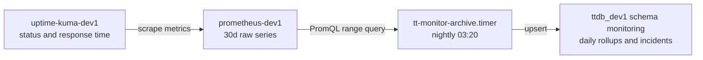

<!-- TermiteTowers Continuous Code Management Header TEMPLATE --- %ccm_git_header_start:  % -->
<!-- %ccm_git_repo: TermiteTowers % -->
<!-- %ccm_git_branch: dev1 % -->
<!-- %ccm_git_path: plans/uptime-kuma-update-and-monitoring-archive.md % -->
<!-- %ccm_git_object_id: plans/uptime-kuma-update-and-monitoring-archive.md@216 % -->
<!-- %ccm_git_commit_date: 2026-11-13 11:40:17 -0500 % -->
<!-- %ccm_git_commit_author: mpegg % -->
<!-- %ccm_git_commit_message: chore(uptime-kuma): pin 2.5.11 after upgrading from 2.4.0 % -->
<!-- TermiteTowers Continuous Code Management Header TEMPLATE --- %ccm_git_header_end:  % -->
# Plan: Update Uptime Kuma, then archive monitoring history

Status: **Part 1 complete 2026-11-13. Part 2 deferred by decision** — no Part 2 repo or host work has been done.
Scope: dev1, `monitor-apps-net-dev1`, `ttdb_dev1`
Related: [`plans/prometheus-useful.md`](prometheus-useful.md) (implemented Phases 0-7; this plan extends its metrics layer rather than duplicating it)

## Part 1 — Update `uptime-kuma-dev1`

### What is actually being changed

| Fact | Source |
|---|---|
| Image is `louislam/uptime-kuma:2` — a **floating 2.x tag**, so an update is `pull` + recreate, not a file edit | [`infra/docker/uptime-kuma-dev1.yml:38`](../infra/docker/uptime-kuma-dev1.yml:38) |
| This is the same shape as the Pi-hole update: `pihole/pihole:latest`, no repo change needed | [`infra/docker/pihole-dev1.yml:34`](../infra/docker/pihole-dev1.yml:34) |
| All state is one SQLite database under the bind mount, migrated in place by Kuma on first start | [`infra/docker/uptime-kuma-dev1.yml:44`](../infra/docker/uptime-kuma-dev1.yml:44) |
| No healthcheck is defined, so the update has no machine-readable success signal | [`infra/docker/uptime-kuma-dev1.yml:37`](../infra/docker/uptime-kuma-dev1.yml:37) |
| `wiki/runbook-uptime-kuma.md` is start/stop only — there is no documented update or rollback procedure | [`wiki/runbook-uptime-kuma.md:30`](../wiki/runbook-uptime-kuma.md:30) |

The real risk is not the image; it is the SQLite migration. Kuma migrations are forward-only,
so an interrupted or failed migration leaves a database no earlier image can open.

Two facts were corrected against the host during execution, both of which change the plan below:

- The image ships its own `HEALTHCHECK`, which is why `docker ps` reports `(healthy)`. No compose-level
  healthcheck was needed or added — the earlier assumption that there was no signal was wrong.
- The compose file and the runbook are **LF**, despite CCM headers claiming `CRLF` in both. Anything
  rewriting line endings on a byte match will silently fail.

### Outcome (2026-11-13)

| Item | Value |
|---|---|
| From / to | 2.4.0 (image built 2026-05-31) → **2.5.11** (built 2026-11-12) |
| Snapshot | `/mnt/ai_storage/uptime-kuma/backups/pre-2.4.0-20261113/` (71 MB) |
| Rollback image | `louislam/uptime-kuma:2.4.0-rollback` (local tag of the pre-update image) |
| Integrity after migration | `PRAGMA integrity_check` → `ok` |
| Row counts | monitor 15 → 15, heartbeat 24107 → 24131, stat_daily 2337, stat_hourly 9473, stat_minutely 17867, notification 1 — unchanged or grown |
| Migration errors | none in the logs; `Connected to the database`, listened on 3001 |
| `/metrics` | **401**, not 404 — the endpoint exists but requires a bearer token generated in the Kuma settings UI |

### Steps

1. **Record the current version** before touching anything, so rollback has a target:
   `docker inspect -f '{{index .Config.Labels "org.opencontainers.image.version"}}' uptime-kuma-dev1`
   and note the monitor count and a couple of uptime percentages from the UI.
2. **Snapshot the data directory** at a path that will not be overwritten by the next attempt:
   stop the container, `rsync -a` the whole `/mnt/ai_storage/uptime-kuma/data` to
   `/mnt/ai_storage/uptime-kuma/backups/pre-<version>-<date>/`, start it again.
   Copy the directory rather than only `kuma.db` so `-wal` and `-shm` travel with it.
3. **Pull and recreate**: `docker compose -f infra/docker/uptime-kuma-dev1.yml pull` then `up -d`.
4. **Watch the migration** in `docker logs -f uptime-kuma-dev1` until the server announces it is
   listening. Treat a migration error as stop-and-restore, not retry.
5. **Verify**: UI login, monitor list and uptime bars intact, one notification test delivered,
   `curl -s http://192.168.1.10:3700/metrics | head` (Part 2 depends on this endpoint, so confirm it now).
6. **Pin the version** to the exact release that just proved itself, matching the house precedent of
   `nextcloud:32.0.5-apache` and `node-exporter:v1.8.2`. A floating `:2` means the next restart can perform
   an unreviewed migration at an arbitrary moment.
7. **Add a healthcheck** to the compose file so the update and future restarts are observable.
8. **Write the update procedure into the runbook** — the current file only covers start/stop and data paths.

### Rollback

Stop the container, move the new data directory aside, restore the snapshot directory, then run the
previous image tag explicitly. Do not attempt an in-place downgrade: the migrated schema will not open.

## Part 2 — Capturing monitoring history for the long term

> **Deferred by decision on 2026-11-13.** Part 1 was taken alone: update and pin Kuma, hold the
> archive design for a later pass. Everything below is design only — no schema, script, timer or
> scrape job exists in the tree. It is kept because the reasoning and the host facts are the
> expensive part to re-derive.
>
> One host fact is already settled and shapes the work: Kuma's `/metrics` responds **401**, so a
> scrape job needs a token from Settings → API Keys. That makes the exporter path slightly more
> than "scrape a URL", and it is the first thing to resolve whenever this resumes.

### The gap

Neither current store keeps history:

- Uptime Kuma keeps heartbeats and its own daily rollups inside `kuma.db`, with per-monitor retention.
  It answers "last quarter" reasonably well, then discards, and the answer dies with the SQLite file.
- Prometheus keeps 30 days and a hard 5 GB cap ([`infra/docker/prometheus-dev1.yml:66`](../infra/docker/prometheus-dev1.yml:66)).
  It is a short-horizon store by design.

So "what was the availability of PowerDNS in Q1 2026, and how long were the outages" has no answer two
years from now. That is the thing worth fixing, and it is cheap: availability rolled to daily
granularity is one row per monitor per day.

### Design

| Decision | Choice | Why |
|---|---|---|
| Data source | Prometheus HTTP API, **not** `kuma.db` | The Kuma database is a live WAL SQLite owned by the application, and its schema changes across 2.x releases. The Prometheus query API is stable, and its 30-day window covers any gap in the nightly job. |
| Metric transport | Scrape Kuma's `/metrics` | Zero new containers, and both services already share `monitor-apps-net-dev1`, so the target is a service name with no published port. |
| Storage | `ttdb_dev1` schema `monitoring` on the host Postgres | Matches the existing history-in-Postgres precedent (`dhcp_history` 2.5 M rows, `watchyourlan` 149 K rows) and the per-schema role pattern in [`setup-dhcp-history-db.sh`](../infra/dhcp/scripts/monitoring/setup-dhcp-history-db.sh:73). |
| Granularity | Daily rollups plus discrete incidents | Daily rows are negligible in volume and answer trend questions; incidents preserve the exact minute-level boundaries that daily rows lose. |
| Long-term metrics store | **Deferred** | VictoriaMetrics or Thanos would preserve every series forever. That is a bigger commitment than the stated need, and it belongs behind the same "only once the query is needed repeatedly" bar that deferred Grafana. |

### Phases

**Phase A — Kuma into Prometheus** (small, do immediately after Part 1)

1. Add an `uptime-kuma` job to [`infra/docker/prometheus/prometheus.yml`](../infra/docker/prometheus/prometheus.yml:31)
   targeting `uptime-kuma:3001`, with an `instance: uptime-kuma` label.
2. Confirm the endpoint's real series names from
   `curl -s http://127.0.0.1:3720/api/v1/label/__name__/values` before writing any PromQL — do not assume
   the exported metric names.
3. Extend [`tests/prometheus/test_prometheus_config.sh`](../tests/prometheus/test_prometheus_config.sh:41)
   with the same class of assertion the file already makes for `node-exporter:9100`: the Kuma target is a
   container name, never `localhost:<port>`.
4. Reload and verify `up{job="uptime-kuma"} == 1`.

**Phase B — schema**

New: `infra/sql/monitoring/schema.sql`, `infra/dhcp/scripts/monitoring/setup-monitoring-db.sh`-style
setup script (modelled on the existing DHCP one, same role, schema, `search_path` and default-privilege
sequence).

| Table | Columns | Notes |
|---|---|---|
| `monitor` | `monitor_id`, `name`, `type`, `target`, `first_seen`, `last_seen` | Dimension; upserted every run so renames and new monitors are captured. |
| `monitor_daily` | `monitor_id`, `day`, `checks`, `up_checks`, `uptime_ratio`, `avg_response_ms`, `max_response_ms`, `p95_response_ms` | PK `(monitor_id, day)`. `NULL` ratio, not 0, when a monitor did not exist that day. |
| `monitor_incident` | `monitor_id`, `started_at`, `ended_at`, `duration_s`, `last_status`, `error` | One row per contiguous down window, derived at 1-minute resolution. Open incidents re-written each run once `ended_at` is known. |

**Phase C — the archiver**

New: `scripts/archive-monitor-metrics.sh`, `infra/systemd/tt-monitor-archive.service`,
`infra/systemd/tt-monitor-archive.timer`.

1. Query `http://127.0.0.1:3720/api/v1/query_range` over a 3-day window per run, so a single missed night
   self-heals — 3 days is well inside the 30-day retention.
2. Compute per-monitor-per-day `avg_over_time`, `min_over_time` and `count_over_time` on the uptime and
   response-time series, then incident windows via a contiguous-zero scan.
3. Write with `INSERT ... ON CONFLICT DO UPDATE` so re-running a day is idempotent and never duplicates.
4. Follow the [`emit-backup-metrics.sh`](../scripts/emit-backup-metrics.sh:32) conventions for script shape:
   `set -Eeuo pipefail`, a documented metrics/exit contract, and a heartbeat row so a silently dead timer
   is visible in the data rather than absent from it.
5. Credentials through the per-tier secrets path only — an `EnvironmentFile` holding `PGPASSWORD`, never a
   committed value. The unit runs as `mpegg-adm` with `ProtectSystem=strict`, `NoNewPrivileges=yes`,
   `PrivateTmp=yes` and no `ReadWritePaths` at all: it needs the network and nothing on disk.
6. Timer nightly, `OnBootSec` as well as `OnCalendar`, so a host that is off at 03:20 still catches up.

**Phase D — documentation and tests**

1. New `wiki/runbook-monitoring-archive.md`: what is stored, where, the restore/rebuild path, and why the
   source is Prometheus rather than `kuma.db`.
2. Add the `monitoring` schema to [`wiki/databases.md`](../wiki/databases.md:29) alongside `dhcp_history`.
3. `tests/monitoring/` covering: SQL applies twice without error, the archiver's day-boundary and gap math
   against fixture JSON, and an open incident that later closes.
4. Update [`infra/docker/README.md`](../infra/docker/README.md:39) if Phase A's compose change alters the
   inventory description.

## Acceptance criteria

- `uptime-kuma-dev1` runs the pinned version, survives a restart, and keeps its monitor history
- `up{job="uptime-kuma"} == 1` in Prometheus
- `select count(*) from monitoring.monitor_daily where day = current_date` returns one row per monitor
- A deliberately stopped monitor appears as exactly one closed incident row after the next run
- Re-running the archiver for the same day changes nothing and duplicates nothing
- `tests/prometheus/test_prometheus_config.sh` still passes, extended with the Kuma target assertions
- `scripts/check-tier-paths.py` exits 0

## Rollback

Part 1 is a directory restore plus a tag change. Phase A is one job block in a git-tracked file.
Phases B-C are additive: dropping the schema removes the archive and nothing else reads it. No phase
touches the Kuma database or the Prometheus TSDB contents.

## Open verifications (host-side, not answerable from the repo)

Resolved during Part 1: the installed version is 2.5.11, and `/metrics` exists on it but returns 401.

Still open, and only relevant if Part 2 resumes:

- Which series names the tokenised `/metrics` actually exposes, and at what cardinality per monitor.
- Real `mountpoint`-style label values, if any rule is ever written against the archived data.
- Whether the host Postgres role creation path works without an interactive `sudo -u postgres` — `sudo`
  needs a password on this host, so the DHCP setup script's `sudo -u postgres psql` pattern needs a
  docker-exec or `PGPASSWORD` route instead.
- Whether `/mnt/ai_storage/uptime-kuma/backups/` should be added to the `emit-backup-metrics.sh` job
  list, so Kuma snapshots become a `BackupStale` series like the others. This is now cheap and
  probably worth doing before Part 2 resumes.
