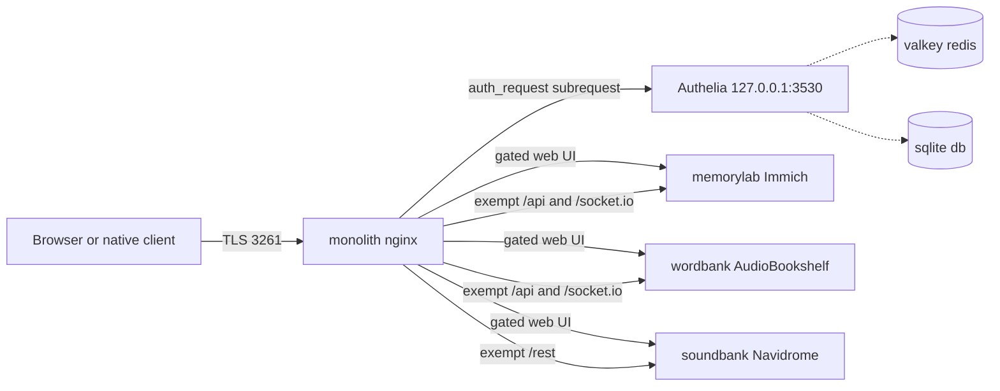

<!-- TermiteTowers Continuous Code Management Header TEMPLATE --- %ccm_git_header_start:  % -->
<!-- %ccm_git_repo: TermiteTowers % -->
<!-- %ccm_git_branch: dev1 % -->
<!-- %ccm_git_path: wiki/runbook-authelia.md % -->
<!-- %ccm_git_object_id: wiki/runbook-authelia.md@199 % -->
<!-- %ccm_git_commit_date: 2026-10-31 16:55:50 -0400 % -->
<!-- %ccm_git_commit_author: mpegg % -->
<!-- %ccm_git_commit_message: fix(docs): correct the edge model — WAN 443 is DNATed to 3261 % -->
<!-- TermiteTowers Continuous Code Management Header TEMPLATE --- %ccm_git_header_end:  % -->
<!-- %git_commit_history: 2026-10-31 mpegg feat(scripts): one-shot deploy for the analacres hosts -->
<!-- %git_commit_history: 2026-10-31 mpegg feat(nginx): expose wordbank and soundbank, make analacres hosts gate-ready -->
# Runbook — Authelia gate for the analacres.ca service family

**Status:** Phase 1 landed. The three vhosts are **gate-ready but ungated**.
Phase 2 (deploy Authelia, flip the switch) is pending and requires no vhost edit.

Services in scope, all proxied from nginx on `monolith` to `bosman`
(`192.168.4.63`):

| Hostname | Backend | App |
| --- | --- | --- |
| `memorylab.analacres.ca` | `localhost:3400` | Immich |
| `wordbank.analacres.ca` | `192.168.4.63:13378` | AudioBookshelf |
| `soundbank.analacres.ca` | `192.168.4.63:4533` | Navidrome |

The existing `*.termitetowers.ca` hostnames and `pics.justanotherhuman.ca`
stay **ungated** and must remain so.



## 1. How the gate is wired

Two snippet files, both in `infra/nginx/snippets/`, installed to
`/etc/nginx/snippets/`, and both included by every vhost that may be gated:

| File | Included | Role |
| --- | --- | --- |
| `tt-gate-location.conf` | once per vhost, at `server` level | defines `location = /internal/tt-authz`, the `internal` subrequest target that calls Authelia. Unreachable from a client. |
| `tt-gate.conf` | inside the **protected `location` only** | the `auth_request` directives. **Currently comments only — inert.** |

### Why the gate is inside the location and not at server level

`error_page 401 =302 $tt_redirection_url` is what turns an unauthenticated
request into a redirect to the portal. `error_page` is inherited by every
location in a server block. At `server` level it would therefore rewrite
AudioBookshelf's and Navidrome's **own** 401 responses — the ones their
mobile clients parse — into portal redirects, and every native client would
break. Scoping the include to the protected `location` keeps the redirect
from ever touching the exempt API paths.

### Exempt paths, and why

A browser redirect gate cannot work for a client that authenticates
per request with its own token.

| Vhost | Exempt | Reason |
| --- | --- | --- |
| memorylab | `/api/` | Immich app token auth, including `/api/socket.io` |
| wordbank | `/api/`, `/socket.io/` | AudioBookshelf app bearer token + realtime channel |
| soundbank | `/rest/` | Subsonic API, including `/rest/stream` |

`/api/tags/` on memorylab is a **longer** prefix than `/api/`, so nginx routes
there first and it keeps the gate. Deleting that location would silently open
the AI tag backend. This is the single most load-bearing line in
`immich.conf`.

**What this does not protect:** the exempt APIs remain reachable by anyone who
knows the hostname, and are then secured only by the application's own
credentials. The gate protects the web UIs and casual discovery.

### `proxy_pass` trailing-slash trap

In every exempt location the `proxy_pass` has **no URI part**:

```nginx
proxy_pass http://192.168.4.63:13378;   # correct — /api/... arrives intact
proxy_pass http://192.168.4.63:13378/;  # WRONG — strips the matched prefix
```

With a URI part, nginx replaces the matched prefix, so `/api/items` becomes
`/items` and the app 404s. The root `location /` keeps its trailing slash
because the matched prefix is `/` and nothing is lost.

## 2. Pinned constants — do not change without editing every vhost

These are decided now precisely so Phase 2 changes nothing structural:

| Constant | Value |
| --- | --- |
| Portal hostname | `auth.analacres.ca` |
| Portal URL | `https://auth.analacres.ca` |
| Session cookie domain | `analacres.ca` |
| Listener | `3261` on monolith, shared by all analacres.ca vhosts |
| Authelia container port | `9091` |
| Authelia loopback publish | `127.0.0.1:3530` |

The cookie domain is `analacres.ca`, so **one login covers every gated host**
and every future `*.analacres.ca` service. All three gated hosts are suffixes
of that one domain, which is what Authelia requires — no cookie entry may be a
suffix of another.

**The portal URL must carry no port.** The router DNATs WAN `443` to monolith
`3261`: browsers and apps reach every analacres.ca vhost on **443**, while nginx
listens on `3261` internally. Writing `:3261` into `authelia_url` would send
users to a port the WAN does not expose, and because that value is baked into
the session-cookie configuration it would be wrong for every host at once.

Verified live: `https://memorylab.analacres.ca/` returns **200** with a valid
certificate, resolved to the WAN IP `198.251.57.103`, arriving at the same nginx
that answers on `127.0.0.1:3261`.

## 3. Phase 2 — enabling the gate

Prerequisites, in order. Do not skip 2 or 3: a vhost that includes a
non-existent snippet fails `nginx -t`, and an `auth_request` with no Authelia
behind it turns every gated page into a 502.

1. **Deploy Phase 1** — certificates, snippets, vhosts, DNS, verification:

   ```bash
   ./scripts/deploy-analacres-hosts.sh --dry-run   # preview, no privileges
   ./scripts/deploy-analacres-hosts.sh             # deploy: one password prompt
   ```

   The script issues the per-host certs through the GoDaddy DNS-01 hooks,
   symlinks both snippets into `/etc/nginx/snippets/`, enables the three
   vhosts, runs `nginx -t`, reloads **only** if that passes, publishes the A
   records, and verifies every endpoint over loopback. It is idempotent
   (existing certs are skipped) and it refuses to deploy if `tt-gate.conf`
   contains anything but comments — which is what stops a half-gated host
   from going live before Authelia exists.

2. **Deploy Authelia** on monolith. Skipped here as a deployment recipe: see
   §4 for the config skeleton. Prove it answers before going further:

   ```bash
   curl -s http://127.0.0.1:3530/api/health     # expect {"status":"OK"}
   ```

3. **Issue the portal certificate, add its A record, add the auth vhost** —
   §5 and §6.

4. **Enrol a user** in the portal: password, TOTP, and a WebAuthn passkey.
   Store the one-time **recovery codes offline**. There is no email path (§7),
   so recovery codes are the break-glass.

5. **Flip the gate.** Replace the body of
   `infra/nginx/snippets/tt-gate.conf` with the ACTIVE BODY documented in that
   file, then:

   ```bash
   sudo nginx -t && sudo systemctl reload nginx
   ```

   No vhost file is touched. All three hosts go live simultaneously because
   they share the one snippet and the one cookie domain.

6. **Run the test matrix** — §8.

### Rollback and break-glass

* **Disable the gate everywhere:** restore `tt-gate.conf` to comments,
  `nginx -t`, reload. Exempt locations never had the gate, so native clients
  are unaffected either way.
* **Disable one host:** remove the single `include .../tt-gate.conf;` line
  from that vhost's protected location.
* **Authelia down:** the gate fails closed — gated pages return 502, exempt
  APIs keep working. `tt-gate-location.conf` sets a 2 s connect and 5 s read
  timeout so a hung Authelia cannot wedge every request.
* **Lost 2FA device:** recovery codes. **Not** an email reset.

## 4. Phase 2 — Authelia config skeleton

Not yet deployed. Kept here so deployment is mechanical. Secrets come from
`scripts/gen-secret-hex.sh`, never from this file.

```yaml
# infra/docker/authelia-dev1/configuration.yml
theme: auto
default_redirection_url: 'https://wordbank.analacres.ca'

server:
  address: 'tcp://0.0.0.0:9091'

log:
  level: info

authentication_backend:
  file:
    path: /config/users_database.yml

access_control:
  default_policy: deny
  rules:
    - domain: 'analacres.ca'
      policy: two_factor

session:
  secret: '${AUTHELIA_SESSION_SECRET}'
  cookies:
    - domain: 'analacres.ca'
      authelia_url: 'https://auth.analacres.ca'
      default_redirection_url: 'https://wordbank.analacres.ca'
  redis:
    host: 'authelia-redis'
    port: 6379

storage:
  encryption_key: '${AUTHELIA_STORAGE_ENCRYPTION_KEY}'
  local:
    path: /config/db.sqlite3

notifier:
  filesystem:
    filename: /config/notification.txt

identity_validation:
  reset_password:
    jwt_secret: '${AUTHELIA_JWT_SECRET}'
```

Notes that matter:

* `policy: two_factor` is what makes this more than a username and password:
  TOTP or a passkey is required after the password.
* SQLite plus one Authelia instance is the supported "lite" topology. No
  Postgres needed, and no second moving part to back up.
* `notifier: filesystem` keeps mail out of the critical path. See §7.
* Compose must publish `127.0.0.1:3530:9091` — bound to loopback, so nginx is
  the only client and the portal never appears on the LAN or WAN by accident.
* The `/config` directory must be writable by the container user because
  SQLite lives there.

## 5. Phase 2 — portal certificate and vhost

Certificate, using the same DNS-01 method as `memorylab` — see
`infra/nginx/README.md` for the full command with the GoDaddy hooks:

```bash
sudo certbot certonly --manual --preferred-challenges dns \
  --manual-auth-hook /home/mpegg-adm/source/TermiteTowers/infra/certbot/godaddy-auth-hook.sh \
  --manual-cleanup-hook /home/mpegg-adm/source/TermiteTowers/infra/certbot/godaddy-cleanup-hook.sh \
  --key-type ecdsa -d auth.analacres.ca
sudo certbot renew --dry-run          # must pass non-interactively
```

Then uncomment `"analacres.ca:auth"` in `infra/dns/godaddy-ddns.sh` and run
the timer.

The vhost goes on the 3261 listener, **ungated** — it must be reachable
*before* login. It is the one new vhost Phase 2 adds:

```nginx
server {
    listen 3261 ssl;
    server_name auth.analacres.ca;

    ssl_certificate     /etc/letsencrypt/live/auth.analacres.ca/fullchain.pem;
    ssl_certificate_key /etc/letsencrypt/live/auth.analacres.ca/privkey.pem;

    ssl_protocols       TLSv1.2 TLSv1.3;
    ssl_session_tickets off;
    add_header Strict-Transport-Security "max-age=31536000" always;

    location / {
        proxy_pass http://127.0.0.1:3530;
        proxy_set_header Host              $host;
        proxy_set_header X-Real-IP         $remote_addr;
        proxy_set_header X-Forwarded-For   $proxy_add_x_forwarded_for;
        proxy_set_header X-Forwarded-Proto $scheme;
        proxy_http_version 1.1;
        proxy_set_header Upgrade    $http_upgrade;
        proxy_set_header Connection "upgrade";
    }
}
```

Add a `limit_req` zone on the portal: it is the only password-accepting
surface in the whole family, so it is the only place brute-force rate limiting
buys anything.

## 6. Verification matrix

Run after the flip. The `--resolve` checks below aim at `127.0.0.1:3261`, which
tests nginx directly and separates a vhost fault from a network fault. Public
URLs carry no port — WAN 443 is DNATed to 3261 — so the path a browser actually
takes is `https://wordbank.analacres.ca/`.

**Two traps that will otherwise produce a false pass:**

* `soundbank.analacres.ca/` answers **302 to `/app/`** from Navidrome itself.
  An unauthenticated pre-gate check therefore looks *identical* to a gated one.
  Compare the redirect **target**: `/app/` means ungated and healthy, the portal
  host (`auth.analacres.ca`) means the gate is doing its job. Do not assert
  "not 302" on this host.
* `memorylab /api/tags/` returns **502 today** because nothing listens on
  `localhost:3410` — ports 3410-3412 are closed (verified). That is
  pre-existing and unrelated to the gate. Expect the gate to redirect *before*
  the 502 appears; do not chase the 502 during the flip.

```bash
R='--resolve %s:3261:127.0.0.1'
# 1. Unauthenticated web UI → 302 to the portal
curl -sS -o /dev/null -w '%{http_code} %{redirect_url}\n' --resolve wordbank.analacres.ca:3261:127.0.0.1 https://wordbank.analacres.ca/
# 2. Authenticated → 200  (browser, with the analacres.ca cookie)
# 3. Exempt API → must NOT be 302
curl -sS -o /dev/null -w '%{http_code}\n' --resolve wordbank.analacres.ca:3261:127.0.0.1 https://wordbank.analacres.ca/api/status
curl -sS -o /dev/null -w '%{http_code}\n' --resolve soundbank.analacres.ca:3261:127.0.0.1 'https://soundbank.analacres.ca/rest/ping.view?u=USER&t=TOKEN&s=SALT&v=1.16.1&c=tt&f=json'
# 4. /api/tags stays gated
curl -sS -o /dev/null -w '%{http_code} %{redirect_url}\n' --resolve memorylab.analacres.ca:3261:127.0.0.1 https://memorylab.analacres.ca/api/tags/
# 5. pics and the teritetowers hosts stay ungated
curl -sS -o /dev/null -w '%{http_code}\n' --resolve pics.justanotherhuman.ca:3261:127.0.0.1 -k https://pics.justanotherhuman.ca:3261/
# 6. One login covers all three: log in once, then load each host without re-auth
```

Also re-run the native-client checks from the Phase 1 baseline: Immich app
sync, AudioBookshelf app library **and playback**, Subsonic client streaming.
Exemptions were chosen from documented API prefixes; the client test is what
proves them.

## 7. Why there is no email code

`hal@termitetowers.ca` via `ttmail` was the original idea and is **not** part
of this design:

* `ttmail` wraps `awmail`, which talks to the Proton **Bridge on loopback**.
  A container cannot reach it: `host.docker.internal` resolves to the docker
  bridge, not to `127.0.0.1` on the host. Using it from Authelia would need an
  SMTP relay as a third service.
* Authelia does not do emailed login codes. Its second factors are TOTP,
  WebAuthn/passkeys and Duo. Email is only used for identity verification and
  password reset — neither is required to log in.
* Adding a mail dependency would put the Proton Bridge on the critical path of
  every login. TOTP and passkeys do not.

If identity-verification mail is wanted later, add a small relay in front of
`awmail` and point `notifier.smtp` at it. That is a separate, optional task;
`AWMAIL_ALLOW` would then act as the recipient allowlist, and its 60/hour cap
would apply to reset mail.

## 8. Findings recorded during Phase 1

Six things were verified live on monolith and are not assumptions:

1. **The edge is one port, DNATed.** WAN `443` → monolith `3261`. So 3261 is
   *not* exposed directly, and every analacres.ca URL is portless. Two earlier
   conclusions in this document were wrong because they probed `:3261` on the
   WAN IP — a port that was never forwarded — instead of 443. Corrected here:
   **hairpin NAT works**, and `https://memorylab.analacres.ca/` returns 200 with
   a valid certificate from inside the LAN, resolved to the WAN IP.
2. **No internal DNS record for analacres.ca, and none is needed.** Pi-hole
   forwards `termitetowers.ca` (and the internal `.omp` zones) to PowerDNS, and
   there is no `analacres.ca` zone. LAN queries therefore fall through to
   GoDaddy, get the WAN IP, and — because hairpin works on 443 — land back on
   monolith correctly. LAN clients reach these hostnames exactly as external
   clients do. The only cost is that LAN traffic hairpins through the router
   instead of staying local; a PowerDNS zone would be an optimisation, not a fix.
3. **`pics.justanotherhuman.ca` has no matching certificate.** The
   `justanotherhuman.ca` certificate covers only the apex and `www`; the
   memorylab certificate covers only `memorylab.analacres.ca`. That
   `server_name` therefore fails TLS validation and is effectively vestigial —
   real pics traffic is `https://justanotherhuman.ca:3260/pics/`, which
   returns 200. It was kept and left ungated rather than removed, because
   removing a name is a behaviour change and this work must not make one.
4. **WAN reachability of port 3261 is unverified.** From inside the LAN it is
   indistinguishable from "no port forward at all". Confirm from a cellular
   connection; if 3261 is not forwarded, all three hostnames are LAN-only.
5. **Prefix preservation is proven, not assumed.** A throwaway nginx on an
   unprivileged port, running these exact vhosts against the real backends,
   returned Immich `{"res":"pong"}` for `/api/server/ping`, AudioBookshelf's
   own `401 Unauthorized` for `/api/status`, and Navidrome's Subsonic JSON for
   `/rest/ping.view`. A stripped prefix would have produced a 404 in every
   case. The same run confirmed `nginx -t` passes with all three vhosts sharing
   port 3261, that `pics` still serves 200, and that the gated roots serve with
   no redirect while the gate is inert.
6. **The AI tag API is down.** Nothing listens on `localhost:3410`-`3412`, so
   `memorylab /api/tags/` returns 502 today, before and independently of this
   change. Not a regression; noted so it is not mistaken for one during the
   flip.

## 9. Related

* `infra/nginx/snippets/tt-gate.conf` — the switch
* `infra/nginx/snippets/tt-gate-location.conf` — the authz target
* `infra/nginx/sites-available/immich.conf` — memorylab + pics
* `infra/nginx/sites-available/library.conf` — wordbank + library
* `infra/nginx/sites-available/music.conf` — soundbank + music
* `infra/dns/godaddy-ddns.sh` — A records
* `infra/nginx/README.md` — certificate commands
* `wiki/ports.md` — port allocations
