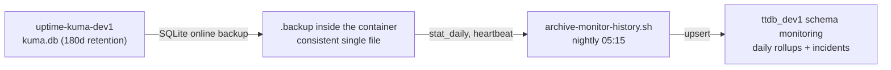

<!-- TermiteTowers Continuous Code Management Header TEMPLATE --- %ccm_git_header_start:  % -->
<!-- %ccm_git_repo: TermiteTowers % -->
<!-- %ccm_git_branch: dev1 % -->
<!-- %ccm_git_path: wiki/runbook-monitoring-archive.md % -->
<!-- %ccm_git_object_id: wiki/runbook-monitoring-archive.md@220 % -->
<!-- %ccm_git_commit_date: 2026-11-13 19:11:14 -0500 % -->
<!-- %ccm_git_commit_author: mpegg % -->
<!-- %ccm_git_commit_message: feat(monitoring): archive Kuma history from kuma.db into ttdb_dev1 % -->
<!-- TermiteTowers Continuous Code Management Header TEMPLATE --- %ccm_git_header_end:  % -->
# Runbook: Monitoring archive (dev1)

Preserves Uptime Kuma's availability history in Postgres, past the point where
Kuma throws it away. Answers *"what was the availability of PowerDNS in Q1 2026,
and how long were the outages"* two years from now.

Kuma keeps `keepDataPeriodDays = 180` and then prunes. This archive is the only
copy of that history once it rolls off.

## Components

| Piece | What it is | Where |
|---|---|---|
| `scripts/archive-monitor-history.sh` | Snapshot, extract, upsert | repo |
| `tt-monitor-archive.timer` | Nightly 05:15, plus `OnBootSec=10min` | host systemd |
| `monitoring` schema | `monitor`, `monitor_daily`, `monitor_incident`, `archive_run` | `ttdb_dev1` |
| Source | `uptime-kuma-dev1:/app/data/kuma.db` | `monitor-apps-net-dev1` |

Schema: [`infra/sql/monitoring/schema.sql`](../infra/sql/monitoring/schema.sql).
Config is not involved — there is no Prometheus scrape job and no API token.



## Why kuma.db and not Prometheus

The original design scraped Kuma's `/metrics` into Prometheus and archived from
the Prometheus query API. Two things killed it:

1. `/metrics` returns **401** and needs an API key, so the scrape job needed a
   bearer credential that cannot live in the repo-mounted Prometheus config.
2. Prometheus only ever holds what it scraped. The ~181 days already in
   `kuma.db` would never have reached Postgres, so the archive would have
   started from the day it was switched on and silently dropped the backlog.

The cost of the current design, stated plainly: it is coupled to Kuma's SQLite
schema. See *After a Kuma upgrade* below.

## What it writes, and what it cannot

| Table | Source | Coverage |
|---|---|---|
| `monitor` | `monitor` | every monitor, upserted each run so renames and new monitors land |
| `monitor_daily` | `stat_daily` | **all 180 days Kuma retains** — one row per monitor per UTC day |
| `monitor_incident` | `heartbeat` | **roughly the last 2 days** — see below |
| `archive_run` | the run itself | one heartbeat row per run, pruned to 90 |

Two limits worth knowing before trusting a query:

- **`stat_daily.timestamp` is epoch seconds, not milliseconds.** Dividing by
  1000 puts every row in January 1970. The script's tests pin this.
- **Outage boundaries are short-lived at source.** Kuma prunes `heartbeat` to
  about two days plus a handful of flagged transitions, while the `incident`
  table in Kuma is status-page posts, not outages. So `monitor_incident`
  always covers the last day or two only, and **accumulates from each run
  forward**. Outages older than the heartbeat window are gone from Kuma itself
  and cannot be recovered from anything on disk.

Nothing is ever deleted from `monitor_daily` or `monitor_incident`. That is the
point: the archive outlives Kuma's retention.

`uptime_ratio` is `NULL` when `checks = 0`, never `0.0` — a monitoring gap is not
an outage, and conflating them would invent downtime that never happened.

## Running it by hand

```bash
# Nothing written; prints what would be archived.
scripts/archive-monitor-history.sh --dry-run

# Normal run: snapshot, extract, upsert.
scripts/archive-monitor-history.sh

# Use an existing snapshot instead of taking one (offline review).
scripts/archive-monitor-history.sh --db /tmp/kuma-archive-probe/kuma.db --dry-run

# Backfill or repair a narrower range.
scripts/archive-monitor-history.sh --since 2026-05-01
```

It is idempotent: every write is an upsert on the natural key, so re-running a
day rewrites it and never duplicates. Re-running also refreshes today's partial
row, which is why the nightly run is enough and no intraday cadence is needed.

## Install the timer

```bash
sudo install -m 0644 infra/systemd/tt-monitor-archive.service /etc/systemd/system/
sudo install -m 0644 infra/systemd/tt-monitor-archive.timer   /etc/systemd/system/
sudo systemctl daemon-reload
sudo systemctl enable --now tt-monitor-archive.timer
systemctl list-timers 'tt-monitor-archive*'
```

Prove it once before trusting the schedule:

```bash
sudo systemctl start tt-monitor-archive.service
journalctl -u tt-monitor-archive.service -n 30 --no-pager
```

## Reading the data

```sql
-- last run: a stale max(run_at) means the timer died
select run_at, days_written, rows_written, incidents, note
from monitoring.archive_run order by run_at desc limit 5;

-- 30-day uptime per monitor
select m.name,
       round(avg(d.uptime_ratio) * 100, 2) as uptime_pct,
       round(avg(d.avg_response_ms), 1) as avg_ms,
       count(*) as days
from monitoring.monitor_daily d
join monitoring.monitor m using (monitor_key)
where d.day > current_date - 30
group by m.name order by uptime_pct;

-- outages still open at the last run
select m.name, i.started_at, i.error
from monitoring.monitor_incident i
join monitoring.monitor m using (monitor_key)
where i.ended_at is null order by i.started_at desc;
```

`monitor_key` is `kuma:<id>` — Kuma's own numeric monitor id, so it survives a
rename and joins to nothing else by accident.

The read-only MCP role gets `USAGE` + `SELECT`; grant again if the schema is
recreated:

```sql
grant usage on schema monitoring to mcp_readonly;
grant select on all tables in schema monitoring to mcp_readonly;
```

## Exit codes

| Code | Meaning | First check |
|---|---|---|
| 0 | ok | — |
| 2 | a required tool is missing (`sqlite3`, `psql`, `docker`) | `command -v` |
| 3 | bad config, unexpected Kuma schema, or no data | the error text names the table and column |
| 4 | snapshot failed | is `uptime-kuma-dev1` running; `docker exec` reachable |
| 5 | database write failed | `psql -d ttdb_dev1` as `mpegg-adm` |

Because the run is idempotent, re-running after a transient failure is always
safe.

## Troubleshooting

**Exit 3 naming a table and column.** Kuma changed its schema in an upgrade. The
guard exists so this fails loudly instead of writing wrong rows. Inspect the real
schema and update `need_cols`:

```bash
docker exec uptime-kuma-dev1 sqlite3 /app/data/kuma.db '.schema stat_daily'
docker exec uptime-kuma-dev1 sqlite3 /app/data/kuma.db '.schema heartbeat'
```

**Exit 3 with "no stat_daily rows".** `--since` excluded everything, or the
snapshot is not a Kuma database.

**Incidences missing for an old date.** Expected. `heartbeat` is pruned to about
two days; only runs that happened inside that window captured them. The archive
accumulates from now on.

**Integrity check fails.** The snapshot was torn or the file is corrupt. The
script refuses to write from it. Re-run; if it repeats, check container disk and
`docker logs uptime-kuma-dev1`.

**Counts look wrong after a Kuma upgrade.** Run `--dry-run` and compare
`days_written` against `select count(*) from stat_daily` in a fresh snapshot.

## After a Kuma upgrade

The Kuma upgrade procedure is in [`runbook-uptime-kuma.md`](runbook-uptime-kuma.md).
After it, before the next scheduled run:

```bash
scripts/archive-monitor-history.sh --dry-run     # expect exit 0 and a sane day count
bash tests/monitoring/test_monitor_archive.sh    # expectation contract, no DB needed
```

If the dry run exits 3, fix the guards before the timer fires, otherwise the
nightly run stops and the archive silently stops growing.

## Backup

The archive is `general` tier, not `health`: it is derived uptime data, not PHI.

- Until Prometheus/Kuma roll past retention the data is regenerable, so weekly
  is enough; after that this schema is the only copy.
- `pg_dump -n monitoring` is single-digit MB per year.
- Retention: 90 days local, plus a yearly sealed artifact that is never rebuilt
  downward.

`ttdb_dev1` as a whole is backed up by `tt-backup-db-user`; the schema-specific
dump exists so the monitoring history can be restored or moved to `ttdb-arc1`
without dragging `kea` and `dhcp_history` along.

## Tests

```bash
bash tests/monitoring/test_monitor_archive.sh
```

The suite runs against a fixture `kuma.db` through `--dry-run --extract-dir`, so
it needs no Postgres and no Docker. It pins the epoch-seconds rule, the
zero-check skip, the incident coalescing rule, status 2 counting as down, and the
schema guards.
